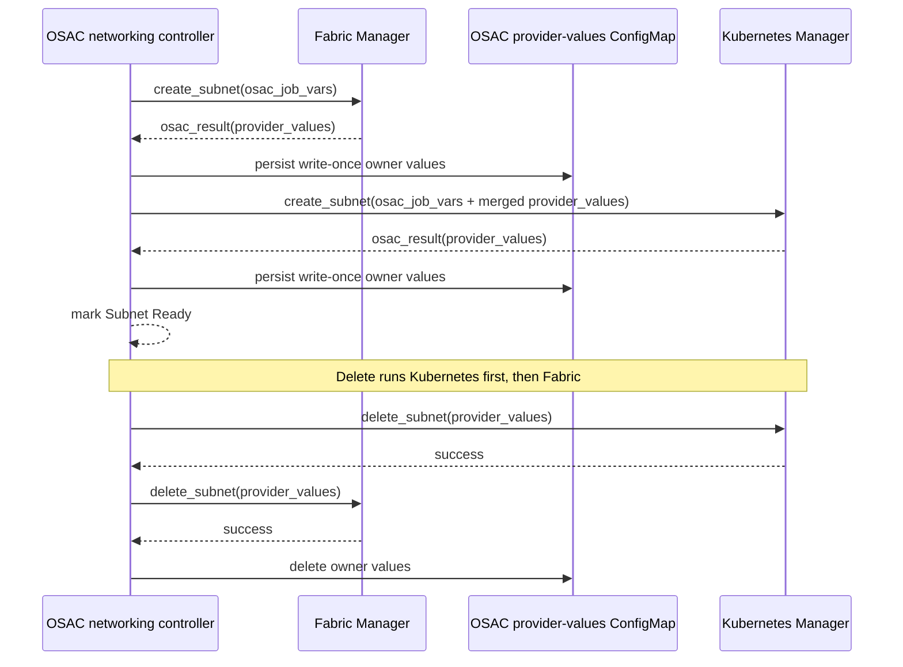

# OSAC Network Manager Integration Contract

| Field | Value |
|-------|-------|
| Author(s) | Dan Manor (dmanor@redhat.com) |
| Jira | https://redhat.atlassian.net/browse/OSAC-1433 |
| PRD | [Network Manager Integration Contract PRD](prd.md) |
| Date | 2026-10-08 |

## Contents

- [1. Overview](#1-overview)
- [2. Goals and Non-Goals](#2-goals-and-non-goals)
  - [2.1 Goals](#21-goals)
  - [2.2 Non-Goals](#22-non-goals)
- [3. Motivation and Background](#3-motivation-and-background)
- [4. Design](#4-design)
  - [4.1 Architecture and Manager Roles](#41-architecture-and-manager-roles)
  - [4.2 Manager registration, capabilities, and limits](#42-manager-registration-capabilities-and-limits)
  - [4.3 API and Manager Task Contract](#43-api-and-manager-task-contract)
    - [Tenant address-space isolation](#tenant-address-space-isolation)
    - [Provider values](#provider-values)
    - [IPAM on a shared Subnet](#ipam-on-a-shared-subnet)
    - [Common AAP input](#common-aap-input)
    - [Canonical serialized task inputs](#canonical-serialized-task-inputs)
    - [Workload attachment policy input](#workload-attachment-policy-input)
    - [Workload attachment result](#workload-attachment-result)
    - [Resource action, manager, and task table](#resource-action-manager-and-task-table)
    - [DHCP-based tenant IPv4 addressing](#dhcp-based-tenant-ipv4-addressing)
    - [Generic AAP role invocation](#generic-aap-role-invocation)
    - [Manager result envelope](#manager-result-envelope)
    - [Stable backend ownership and projection recovery](#stable-backend-ownership-and-projection-recovery)
    - [Idempotency for every manager task](#idempotency-for-every-manager-task)
    - [AAP job identity, polling, and retries](#aap-job-identity-polling-and-retries)
  - [4.4 Manager stage ordering and provider values lifecycle](#44-manager-stage-ordering-and-provider-values-lifecycle)
    - [Workload attachment policy lifecycle](#workload-attachment-policy-lifecycle)
  - [4.5 Scalability and Performance](#45-scalability-and-performance)
  - [4.6 Security Considerations](#46-security-considerations)
  - [4.7 Failure Handling and Recovery](#47-failure-handling-and-recovery)
  - [4.8 RBAC and Tenancy](#48-rbac-and-tenancy)
  - [4.9 Extensibility](#49-extensibility)
  - [4.10 Risks and Mitigations](#410-risks-and-mitigations)
  - [4.11 Drawbacks](#411-drawbacks)
- [5. Interface Changes](#5-interface-changes)
- [6. Alternatives Considered](#6-alternatives-considered)
- [7. Observability and Monitoring](#7-observability-and-monitoring)
- [8. Impact and Compatibility](#8-impact-and-compatibility)
- [Open Questions](#open-questions)

## 1. Overview

The proposal defines two provider-replaceable manager roles, each with a fixed task set: the Fabric Manager configures the provider's physical network, and the Kubernetes Manager configures networking inside the single hosting cluster. A provider may supply either role or both. OSAC owns task selection, execution order, inputs, result validation, retries, and readiness; managers implement their assigned backend behavior and never call one another or write OSAC workload resources.

Managers register through labelled ConfigMaps in the operator namespace. Each task receives the shared `osac_job_vars` input envelope and returns `osac_result` through Ansible `set_stats`; OSAC reads the result from the exact tracked AAP job. OSAC validates typed outputs and stores manager-to-manager values as opaque `provider_values`. The contract defines the task set, attachment behavior, and conformance expectations.

For overlay workload attachments, the Kubernetes Manager installs policy before the VM exists and returns a small attachment descriptor. OSAC validates and stores that descriptor on the internal SubnetAttachment. VMaaS maps the descriptor through a fixed OSAC-owned table and creates the VM with the resulting network fields and its requested run strategy. The manager never reads or modifies the VM. Service controllers own workload sequencing; the networking controller owns attachment task dispatch, result validation, request status, and finalizer handling.

See the [Network Manager Integration Contract PRD](prd.md) for the outcomes this design supports and the [Unified Networking Design](/enhancements/OSAC-1433-unified-networking/design.md) for shared tenant-resource semantics.

## 2. Goals and Non-Goals

### 2.1 Goals

- Specify each manager role's registration, fixed tasks, input envelope, typed results, provider-value exchange, lifecycle, and behavioral requirements.
- Let a manager author implement a role from the contract alone.
- Allow a provider to implement the Fabric Manager, the Kubernetes Manager, or both without provider-specific OSAC code.
- Preserve the same tenant networking API and behavior across workload service extensions.
- Validate manager identity, role, contract version, capabilities, limits, and task results.
- Qualify declared behavior through a repeatable conformance suite; registration and successful task results alone do not establish conformance.
- Use the existing networking fulfillment-group ConfigMap and Secret for provider settings and secrets.

### 2.2 Non-Goals

- Validating that a selected Fabric Manager and Kubernetes Manager are compatible.
- Schemas or validation for values exchanged between managers; `provider_values` are opaque to OSAC.
- Supporting more than one hosting cluster.
- Supporting more than one tenant attachment per workload.

## 3. Motivation and Background

Providers need a clear contract for implementing Fabric and Kubernetes networking roles. The contract assigns the task set and shared envelope while leaving backend realization to each manager. OSAC validates task result shape and identity, sequences manager tasks, stores opaque provider values, and gates readiness and cleanup. Providers document the values they emit and require, then use conformance tests to demonstrate that a selected pair works together.

The Kubernetes Manager does not modify workload resources. For an overlay attachment it installs policy selected by the fixed ComputeInstance API ID label and returns a constrained network descriptor. VMaaS uses the OSAC-owned mapping table to build KubeVirt fields before creating the VM. Fabric attachment tasks manage physical interfaces through the service-owned handoff sequence.

## 4. Design

### 4.1 Architecture and Manager Roles

A **Fabric Manager** configures the provider's physical network fabric for OSAC resources and physical workload interfaces. Its tasks may configure switching, segmentation, routing, DHCP/IPAM, NAT, external addresses, and bare-metal port moves.

A **Kubernetes Manager** configures the network inside the hosting Kubernetes cluster, including overlay or secondary networks, workload attachment policy, and VM addressing. A provider may implement one role or both; the roles remain separate and receive separate task calls. A provider may supply the Kubernetes Manager.

OSAC selects the role from `NetworkClass.fabric_manager` and `NetworkClass.k8s_manager`, chooses the fixed task for the lifecycle action, passes the canonical input envelope, and accepts only a valid task result. Managers never call one another and never write OSAC workload resources. For an existing resource, OSAC records the resolved manager names in `status.networkManagers.fabric` and `status.networkManagers.kubernetes`; deletion and attachment cleanup use those captured names even if NetworkClass later changes. Children and attachment requests inherit the established parent network binding.

Each manager remains responsible for its backend. Manager designs list the `provider_values` keys they emit and require. The provider selects managers whose documented values fit and demonstrates the selected combination through conformance. The [Unified Networking Design](/enhancements/OSAC-1433-unified-networking/design.md) defines tenant semantics, while workload service extensions own when a workload is attached and torn down.

#### Fulfillment-group settings and secrets

Provider backend settings use the existing networking fulfillment group's Kubernetes ConfigMap and Secret. AAP networking job pods receive the group's values as environment variables through the existing instance-group pod configuration. Providers place non-secret configuration in the ConfigMap and credentials in the Secret. Each role owns the variable names it reads; providers should prefix them by manager to avoid collisions. There is no per-manager configuration API field or AAP credential-ID field. All installed roles in the group can read the shared values, so the group is the trust boundary. Secrets do not appear in job variables, manager results, provider values, or task logs.

A provider CA bundle can be supplied through the ConfigMap and used by that manager's client. If a client needs a file, the role writes a job-local file; private key files use restrictive permissions and are removed after use. Pod-wide trust-store changes require execution-environment or pod configuration and are not supplied by the manager contract.

### 4.2 Manager registration, capabilities, and limits

#### Manager registration

Managers register as ConfigMaps in the OSAC operator namespace. The labels are fixed: `osac.openshift.io/network-fabric-manager: "true"` for Fabric and `osac.openshift.io/network-k8s-manager: "true"` for Kubernetes. The `data.name` value is the logical name selected by `NetworkClass.fabric_manager` or `NetworkClass.k8s_manager`, and is also the Ansible role name.

```yaml
apiVersion: v1
kind: ConfigMap
metadata:
  name: network-manager-acme-fabric
  namespace: osac-operator
  labels:
    osac.openshift.io/network-fabric-manager: "true"
data:
  name: acme_fabric
  contract_version: "1"
  capabilities: "ipv4,securityGroups"
  description: "optional free text"
```

`capabilities` is a comma-separated list. `limits` is optional and applies only to a Kubernetes Manager. Unknown capability values are rejected. A registration name must resolve to exactly one ConfigMap with the matching role label. OSAC rejects a missing manager, wrong role, unsupported contract version, unknown capability, or east-west-enabled NetworkClass whose Fabric Manager does not declare `eastWestEthernet`. OSAC does not compare one manager's inputs with another manager's outputs.

A Kubernetes Manager may declare an implementation limit:

```yaml
apiVersion: v1
kind: ConfigMap
metadata:
  name: network-manager-acme-kubernetes
  namespace: osac-operator
  labels:
    osac.openshift.io/network-k8s-manager: "true"
data:
  name: acme_kubernetes
  contract_version: "1"
  capabilities: "ipv4,securityGroups"
  limits: '{"vm_subnets_per_virtual_network": 1}'
```

A provider installs its role in the networking AAP execution environment. OSAC's generic playbook invokes `osac.templates.<name>` with the task selected by OSAC. New task names require an AAP job template in OSAC packaging once; providers do not add OSAC job templates. The provider's manager name and role are captured on the created resource status and reused for delete.

#### Capabilities and limits

Capabilities are a fixed OSAC-defined list, not provider-defined feature names. Fulfillment-service validates NetworkClass capability requests against the fixed API fields; OSAC's manager resolver rejects unknown capability tokens in registration ConfigMaps and checks required declarations during NetworkClass resolution. Capabilities describe behavior that OSAC gates or reports and do not add manager tasks. The fixed list has three values:

| Capability | Role | Functional meaning and use |
|---|---|---|
| `ipv4` | Fabric and Kubernetes | Required for every manager. The role implements the IPv4 behavior of its assigned tasks. OSAC rejects a registration that omits it. |
| `eastWestEthernet` | Fabric | The manager implements `create_fabric_domain` and `delete_fabric_domain`. OSAC dispatches those tasks only when the NetworkClass enables Ethernet east-west behavior and the Fabric Manager declares this capability. |
| `securityGroups` | Both roles | The manager enforces the complete stateful SecurityGroup contract on interfaces its role owns. OSAC reports `NotEnforced` when the interface-owning role does not declare this capability. |

The Kubernetes-only `limits.vm_subnets_per_virtual_network` value declares the maximum number of Subnets that manager realizes for one VirtualNetwork. Subnets beyond the limit are Fabric-only; workload attachment to a Subnet without Kubernetes realization is rejected. The generic limit replaces manager-name checks. The exact rule needs confirmation because today's `cudn_evpn` path refuses a second Subnet only when the first already has VMs; see Open Question 3.

#### East-West capability boundary

`eastWestEthernet` gates optional FabricDomain tasks. A Fabric Manager that declares it implements both fixed task entry points and preserves the VirtualNetwork routing and Subnet broadcast-domain contract. A manager capability alone does not enable the behavior: NetworkClass must also enable Ethernet east-west. If NetworkClass enables the behavior without the capability, resolution fails before any job starts. The [Unified Networking Design](/enhancements/OSAC-1433-unified-networking/design.md) defines the tenant-facing FabricDomain meaning.

### 4.3 API and Manager Task Contract

#### Tenant address-space isolation

The Unified Networking Design defines the tenant meaning of VirtualNetwork and
Subnet. Every conforming manager preserves those boundaries in its backend:
separate VirtualNetworks may use identical or overlapping private CIDRs,
including two networks owned by the same tenant. A CIDR, IP address, MAC
address, or display name alone is not an ownership key. Routing, policy, NAT,
address lookup, allocation, and cleanup use the captured VirtualNetwork
identity and, where applicable, Subnet identity.

Sibling Subnets inside one VirtualNetwork have non-overlapping CIDRs.
Independently owned endpoints attached to one Subnet receive distinct IPv4
addresses and share its L2 broadcast domain; separate Subnets route through
their parent VirtualNetwork. A manager must not infer tenant isolation from a
workload-service boundary, hosting cluster, or separate backend API instance.
Deleting one network owner cannot remove routing, policy, or an address owned
by another, even when their private addresses are equal. Service extensions
define any additional endpoint reservation key while preserving the shared
VirtualNetwork and Subnet scope.

#### Provider values

Either role may return a flat JSON map named `provider_values`. OSAC treats each value as opaque and does not validate its vendor-specific meaning. Each manager design lists the keys its role emits and requires; that documented list and the conformance suite establish the provider's pairing contract. A missing required key fails the consuming task at runtime with a diagnostic.

Recommended storage is one OSAC-owned ConfigMap per owner resource in the networking namespace, named `osac-net-values-<kind>-<api-id>` and owned by that resource. Store the map as `data["values.json"]`. Values are write-once per owner/key: an identical retry is accepted and a changed value fails without replacing the existing value. OSAC passes merged values from applicable owners to later tasks of both roles and deletes the ConfigMap only after both roles finish their delete tasks.

For Subnet work, merged values contain applicable VirtualNetwork values followed by Subnet values. If two owners publish the same key with different values, input resolution fails; equal duplicates collapse to one entry. A task also receives values owned by its current resource when they exist. Managers derive ownership from stable API IDs, not display names, CIDRs, IPs, or MAC addresses.

OSAC-owned storage is recommended because OSAC controls value lifetime through all consumers and enforces write-once behavior. This is not a credentials issue: manager roles can already write to the hub. The design replaces manager-written output ConfigMaps and the Go code that reads their hard-coded keys. It remains open whether values should instead use manager-written ConfigMaps at an OSAC-fixed name and namespace.

Recommended well-known keys have documented meaning but are not interpreted by OSAC: `vlan_id`, `l2_vni`, `l3_vni`, `reserved_ipv4_cidrs`, and `gateway_ipv4`. Vendor-specific keys use a `<manager name>.` prefix.

#### IPAM on a shared Subnet

The role that owns an interface serves that interface's addressing: the Fabric Manager serves physical interfaces, and the Kubernetes Manager serves overlay interfaces. For a Subnet shared by VM and bare-metal workloads, the Fabric Manager reserves the address ranges its DHCP service uses and publishes them as `reserved_ipv4_cidrs`; the Kubernetes Manager excludes those ranges from VM allocation. Both roles exclude `osac_reserved_ipv4_cidrs`, which contains ranges OSAC allocates inside the Subnet, including the reserved VIP range when configured. This prevents overlapping allocations without requiring a manager to know which implementation is paired with it.

The workload guest or host obtains its address, prefix, gateway, and DNS settings through DHCP. Managers do not write static tenant addresses into guests or hosts. Address discovery is service-specific: VMaaS reads the address from VMI status; BMaaS invokes `query_dhcp_lease` after the network handoff.

#### Common AAP input

OSAC starts each task with one `osac_job_vars` object. OSAC chooses `task` from the resource lifecycle and fixed task table; a manager cannot select its own task. Resource identity uses the stable fulfillment API `id`; `metadata.uid` and generation fence the Kubernetes projection. On delete, the task receives the captured resource snapshot when the live object is gone.

```yaml
osac_job_vars:
  contract_version: "1"
  manager: {name: acme_fabric, role: fabric} # role is fabric or kubernetes
  task: create_subnet
  tenant: <tenant-id>
  network_class:
    resource_id: <networkclass-api-id>
    projection_uid: <networkclass-uid>
    vip_prefix_length: 28 # present only when configured
  resource:
    apiVersion: osac.openshift.io/v1alpha1
    kind: Subnet
    id: <subnet-api-id>
    metadata: {uid: <subnet-uid>, generation: 1}
    spec: {}
  virtual_network: {id: <virtual-network-api-id>, metadata: {uid: <vn-uid>}, spec: {}}
  subnet: {id: <subnet-api-id>, metadata: {uid: <subnet-uid>}, spec: {}}
  target: {} # attachment and lease tasks only
  network_attachment: {} # attachment tasks only
  osac_reserved_ipv4_cidrs: []
  provider_values: {}
```

For attachment jobs, `resource` is the internal `SubnetAttachment`. Parent context is passed as `virtual_network` and `subnet` snapshots. The attachment target and normalized `network_attachment` are task-specific inputs described below. The Kubernetes Manager operates on the single hosting cluster given by `OSAC_REMOTE_CLUSTER_KUBECONFIG`; no cluster identifier appears in the envelope.

#### Canonical serialized task inputs

The common envelope has these keys. A key may contain a resource snapshot rather than a live object; it carries the stable API ID and projection UID needed for result fencing.

| Key | Present for | Content |
|---|---|---|
| `contract_version` | All tasks | Supported contract version, currently `"1"`. |
| `manager` | All tasks | `name` and `role` (`fabric` or `kubernetes`). |
| `task` | All tasks | Fixed task name selected by OSAC. |
| `tenant` | All tasks | Tenant ID used for authorization and backend ownership. |
| `network_class` | All tasks | `resource_id`, `projection_uid`, and `vip_prefix_length` when configured. |
| `resource` | All tasks | Full hub resource, including stable API `id`, UID, generation, and spec; captured create-time snapshot on delete if absent. |
| `virtual_network`, `subnet` | Subnet and attachment tasks | Parent snapshots with stable API IDs, UIDs, and CIDRs. |
| `target` | Attachment and lease tasks | Overlay: only `kind: ComputeInstance` and stable API `id`. Physical: BareMetalInstance CR. Lease task: the applicable bare-metal target snapshot. |
| `network_attachment` | Attachment tasks | `subnet`, `interface`, and complete `security_groups` rules. Overlay `interface` has only `type: overlay`; physical `interface` has `type: physical`, selected port `name`, and `mac_address`. |
| `osac_reserved_ipv4_cidrs` | Subnet and attachment tasks for both roles | IPv4 ranges allocated by OSAC inside the Subnet; every allocator excludes them. |
| `provider_values` | All tasks | Merged opaque values from applicable owners; empty map when none exist. |
| Task-specific values | Relevant tasks | Pool, ExternalIP, endpoint/ports, NAT source CIDR, or other fixed typed task input. |

A complete overlay `apply_subnet_attachment` input includes `contract_version`, `manager`, `task`, `tenant`, `network_class`, the SubnetAttachment as `resource`, `target` with ComputeInstance kind and API UUID, `virtual_network`, `subnet`, `network_attachment` with full SecurityGroup rules, `osac_reserved_ipv4_cidrs`, and `provider_values`.

Task-specific inputs include:

| Task | Additional input |
|---|---|
| `create_external_ip_pool`, `delete_external_ip_pool` | Pool CIDR and immutable profile context. |
| `create_external_ip`, `delete_external_ip` | ExternalIP resource and selected pool. |
| `attach_external_ip`, `detach_external_ip` | ExternalIP, endpoint target, routing domain, address, and normalized port mappings. |
| `create_nat_gateway`, `delete_nat_gateway` | NATGateway, VirtualNetwork, source CIDR, and selected ExternalIP. |
| `reserve_cluster_ingress_ip`, `release_cluster_ingress_ip` | ClusterOrder reservation owner, Cluster API ID, VirtualNetwork/Subnet context, and configured guest-ingress range. |
| `query_dhcp_lease` | Bare-metal target, selected physical interface, Subnet reference, and MAC address. |
| `create_fabric_domain`, `delete_fabric_domain` | FabricDomain and associated VirtualNetwork. |

For overlay apply, the VM does not exist yet. The manager installs attachment policy and returns the descriptor defined in [Workload attachment result](#workload-attachment-result); it does not inspect or patch a VM. For physical apply, the target host exists on its provisioning network, and the Fabric Manager applies policy and moves the selected port as required by the workload extension.

AAP job variables contain no credentials. The group Secret remains mounted into the AAP job environment and is not copied into resource snapshots or manager results.

#### Workload attachment policy input

`network_attachment.security_groups` contains the complete effective rules for the selected groups. SecurityGroup rules are stateful and combine as a union per attached interface. A new connection between two OSAC-managed interfaces succeeds only when the source interface's egress and the destination interface's ingress both allow it. Unmatched new traffic is denied; established replies are allowed. Trusted DHCP and gateway address resolution remain available, and tenant-provided DHCP servers are blocked.

The role owning an interface enforces policy when it declares `securityGroups`. It must install policy before tenant traffic can reach that interface. A role without the capability can still complete attachment work, but OSAC reports SecurityGroup enforcement as `NotEnforced`; attachment readiness and enforcement reporting are separate. OSAC must never report an unenforced attachment as policy-enforced.

- **Overlay interface:** Kubernetes `apply_subnet_attachment` runs before the VM exists. It installs policy selected by the fixed label `osac.openshift.io/compute-instance-id: <target.id>`, then returns the attachment descriptor. It never reads, patches, starts, or stops the VM. VMaaS creates the VM only after the SubnetAttachment is ready. A manager must be able to produce the attachment before the VM exists.
- **Physical interface:** Fabric `apply_subnet_attachment` installs policy and configures the requested physical port before the workload extension's handoff gate. BMaaS performs the one handoff reboot only after attachment readiness.
- **Delete:** VMaaS deletes the VM and waits until it is gone before deleting the SubnetAttachment. The Kubernetes Manager then removes attachment-owned policy and per-VM backend objects. BMaaS powers off the host on the tenant network, deletes the SubnetAttachment, waits for port restoration, and only then deprovisions.

When SecurityGroup rules change under the temporary OSAC-5679 update exception, OSAC reruns `apply_subnet_attachment` for each selected attachment. This is an idempotent policy ensure. After VM creation it may update policy, but it must return exactly the previously accepted descriptor and must not read or modify the VM.

#### Workload attachment result

Kubernetes `apply_subnet_attachment` returns facts about its network, not KubeVirt fields. OSAC owns the KubeVirt knowledge and maps this closed descriptor to VM fields:

```yaml
workload_attachment:
  namespace: osac-net-7f3a # created and tenant-labelled by the manager
  network:
    role: primary # primary | secondary
    nad: "" # required for secondary as "<namespace>/<name>"; empty for primary
  binding: l2bridge
```

There is exactly one network and one binding because one SubnetAttachment represents one interface. OSAC constructs the VM fields from this fixed mapping:

| `network.role` | `binding` | VM `spec.template.spec.networks` entry | VM `domain.devices.interfaces` entry | `autoattachPodInterface` |
|---|---|---|---|---|
| `primary` | `l2bridge` | `{name: tenant, pod: {}}` | `{name: tenant, binding: {name: l2bridge}}` | Not set (default). |
| `primary` | `passt` | `{name: tenant, pod: {}}` | `{name: tenant, binding: {name: passt}}` | Not set (default). |
| `secondary` | `bridge` | `{name: tenant, multus: {networkName: <nad>}}` | `{name: tenant, bridge: {}}` | `false`. |
| `secondary` | `sriov` | `{name: tenant, multus: {networkName: <nad>}}` | `{name: tenant, sriov: {}}` | `false`. |

For `primary`, the namespace's primary network (for example a primary UDN) is the pod network, so no NAD is named; OVN-Kubernetes creates it. Today's VM behavior is the `primary`/`l2bridge` row. For `secondary`, the VM gets only the tenant interface; the default pod network is not attached, so first-VMI-interface IP discovery remains unambiguous. Any role/binding pair not in the table is rejected. Adding a binding is an OSAC change with a `contract_version` bump.

Before marking the SubnetAttachment Ready, OSAC validates that `namespace` is set, exists in the hosting cluster, and carries the tenant label; that `network.role` and `binding` form a row in the table; that `network.nad` is set for `secondary` and empty for `primary`; and that no additional descriptor fields are present. The descriptor is deterministic for the same target and Subnet, so a retry returns identical values. The manager ensures any secondary NAD reference exists and is usable before returning it; conformance verifies the reported attachment provides the required connectivity. A naming convention alone does not prove that a NAD was created correctly.

Policy selection uses the fixed label `osac.openshift.io/compute-instance-id: <target.id>`. VMaaS stamps that label on each VM pod template. The manager returns no labels or annotations. The VMaaS design references this table as the single source of truth for constructing KubeVirt fields.

#### Resource action, manager, and task table

OSAC chooses every task from the resource lifecycle and this fixed table. A task file may be a documented no-op, but the file must exist and return a valid result. Create order is Fabric before Kubernetes; delete order is Kubernetes before Fabric. Child resources are created after and deleted before their parents.

| Role | Task (`tasks_from`) | When OSAC calls it | Typed output OSAC consumes |
|---|---|---|---|
| Fabric | `create_virtual_network` / `delete_virtual_network` | VirtualNetwork lifecycle | Optional `backend_id`, written to `status.backendNetworkId`. |
| Fabric | `create_subnet` / `delete_subnet` | Subnet lifecycle | None; may return `provider_values`. |
| Fabric | `apply_subnet_attachment` / `delete_subnet_attachment` | `physical` workload attachment | None. |
| Fabric | `query_dhcp_lease` | Bare metal, after handoff reboot | `dhcp_leases[]`. |
| Fabric | `create_external_ip_pool` / `delete_external_ip_pool` | Pool lifecycle | None. |
| Fabric | `create_external_ip` / `delete_external_ip` | ExternalIP lifecycle | `external_ip.address`; optional `external_ip.provider_reference`. |
| Fabric | `attach_external_ip` / `detach_external_ip` | ExternalIPAttachment lifecycle | None. |
| Fabric | `create_nat_gateway` / `delete_nat_gateway` | NATGateway lifecycle | None. |
| Fabric | `reserve_cluster_ingress_ip` / `release_cluster_ingress_ip` | CaaS guest ingress reservation | `cluster_ingress.address`. |
| Fabric, optional | `create_fabric_domain` / `delete_fabric_domain` | Only when `eastWestEthernet` is declared and enabled | None. |
| Kubernetes | `create_virtual_network` / `delete_virtual_network` | VirtualNetwork lifecycle; no-op allowed | None. |
| Kubernetes | `create_subnet` / `delete_subnet` | Subnet lifecycle in the hosting cluster | None; may return `provider_values`. |
| Kubernetes | `apply_subnet_attachment` / `delete_subnet_attachment` | `overlay` attachment, before VM creation / after VM deletion | `workload_attachment` on apply; none on delete. |

Kubernetes VirtualNetwork tasks are part of the fixed task set. A manager may implement them as no-ops when its backend has no VirtualNetwork-level construct. There are no standalone SecurityGroup tasks: rules travel with every attachment. SecurityGroup rule changes rerun the idempotent attachment ensure task. CaaS ingress task names are the fixed names already used by the CaaS extension design.

#### DHCP-based tenant IPv4 addressing

The role that owns an interface serves that interface's addressing: the Fabric Manager serves physical interfaces and the Kubernetes Manager serves overlay interfaces. On a shared Subnet, the Fabric Manager publishes the DHCP ranges it reserves as `reserved_ipv4_cidrs`; Kubernetes IPAM excludes those ranges. Both roles exclude `osac_reserved_ipv4_cidrs`. This prevents overlap without requiring either manager to know which implementation is paired with it.

Workload guests and hosts obtain IPv4 address, prefix, gateway, and DNS resolver settings through DHCP. Managers configure the backend path and do not write static tenant IPs into workloads. Trusted DHCP and required gateway resolution work even when tenant SecurityGroups deny application traffic; tenant DHCP servers are blocked. Address discovery remains service-specific: VMaaS reads VMI status, and BMaaS calls `query_dhcp_lease` after handoff.

#### Generic AAP role invocation

OSAC uses one generic AAP playbook and task template per fixed operation. The playbook receives the OSAC-selected manager and task and includes the provider role from the existing collection:

```yaml
- name: Run the selected network manager task
  ansible.builtin.include_role:
    name: "osac.templates.{{ osac_job_vars.manager.name }}"
    tasks_from: "{{ osac_job_vars.task }}"
```

The manager name is the same value selected in NetworkClass and registered in the ConfigMap; it is the role name. The task name is selected by OSAC and follows the fixed task table. Providers install the role in the networking AAP execution environment and implement each required task file. Providers add no AAP job templates. OSAC packaging adds a job template once when the fixed task set grows. The generic playbook includes the manager role from `osac.templates.<name>`.

The generic job receives group ConfigMap and Secret values as environment variables. Providers define the names their role reads. OSAC does not attach AAP Credential IDs or place secrets in `osac_job_vars`.

#### Manager result envelope

Every successful manager task returns one AAP artifact named `osac_result`, published with Ansible `set_stats` and read from the exact tracked job. The resource identity and observed generation must match the task's input. `provider_values` is a flat JSON object and may be empty. Typed fields appear only for tasks listed in the fixed task table.

```yaml
- name: Return manager result to OSAC
  ansible.builtin.set_stats:
    aggregate: false
    per_host: false
    data:
      osac_result:
        contractVersion: "1"
        resourceID: "<stable API id>"
        resourceUID: "<hub uid from input>"
        observedGeneration: 1
        data:
          provider_values: {}
          # task-specific examples:
          # external_ip: {address: 198.51.100.19, provider_reference: "..."}
          # dhcp_leases: [{subnet_ref, interface, ip_address, mac_address}]
          # backend_id: "..."
          # workload_attachment: {...}
```

`dhcp_leases[]` uses the exact fields `subnet_ref`, `interface`, `ip_address`, and `mac_address`. The overlay apply result contains the `workload_attachment` shape described above. A task failure fails the play. Before failing, a manager may publish `osac_error: {reason, message, retryable}` with `set_stats`; OSAC retries when `retryable` is true or absent and stops with the supplied reason when it is false.

OSAC rejects a result whose identity or generation does not match the job input, whose typed output is malformed, or whose `provider_values` change an already stored owner/key value. A rejected result fails the task and writes nothing. No-op tasks still return a well-formed success result; conformance, not OSAC result acceptance, proves backend behavior.

#### Stable backend ownership and projection recovery

A fulfillment-service API ID is the stable owner key. Kubernetes UID and generation fence a projection and task result; they do not identify backend ownership. A manager never uses a display name, CIDR, IP, MAC, AAP job ID, or projection UID alone as an ownership key. For attachments, the stable binding identity is workload API ID, logical interface, and Subnet API ID.

A delete uses the manager names captured on the resource when it was created, not the current NetworkClass selection. Child resources and attachment requests inherit the parent network's captured manager binding. A missing or recreated hub projection is not evidence that provider state should be deleted or allocated again; OSAC rebinds only when the authoritative API owner and immutable desired input still match. Managers make every task idempotent by stable API owner and captured input. Delete of absent state succeeds only for that same owner.

#### Idempotency for every manager task

Every manager task is idempotent by stable API ID and captured desired input. Repeating create, apply, or allocation converges on the same owned backend state without duplicating resources, addresses, or policy. Read and lease-query tasks make no unintended changes. Delete of absent state succeeds only for the same owner, and a successful asynchronous delete means the backend has reached its required terminal state.

OSAC runs at most one job at a time per resource and per workload interface. It does not start an opposite action while a job for that owner may still be running. Retries reuse the captured inputs and stored provider values, with backoff starting at two minutes and capped at thirty minutes.

#### AAP job identity, polling, and retries

OSAC tracks the exact AAP job and reads results only from that job, never from the most recent job for a resource. A retry starts after the previous job is terminal and follows the configured backoff unless `osac_error.retryable` is false. It uses the same captured resource snapshot and provider values.

### 4.4 Manager stage ordering and provider values lifecycle

For shared resources, OSAC creates with Fabric before Kubernetes and deletes in reverse. Children complete before parents. A Subnet becomes Ready only after the assigned Fabric and Kubernetes tasks succeed. Stored provider values are passed to later tasks and remain available through both managers' delete tasks; OSAC removes the owner ConfigMap after both delete tasks succeed.



The service controller decides when to create or delete a `SubnetAttachment`, when the workload can proceed, and how teardown is ordered. The networking controller dispatches attachment tasks, validates results, updates SubnetAttachment status, and retains its finalizer until cleanup succeeds.

#### Workload attachment policy lifecycle

For an overlay interface, the Kubernetes Manager's `apply_subnet_attachment` task runs before the VM exists. It installs the complete effective SecurityGroup policy selected by `osac.openshift.io/compute-instance-id: <target.id>` and returns the descriptor. OSAC validates and stores it, then marks the SubnetAttachment ready. VMaaS maps the descriptor through the fixed table and creates the VM with the resulting fields and requested run strategy. A later SecurityGroup rule reapply may run while the VM exists; the manager updates policy only and returns the identical descriptor without reading or modifying the VM.

For physical interfaces, BMaaS provisions on the provisioning network, waits for the Fabric Manager's apply task to install policy and move the port, performs one handoff reboot, then requests `query_dhcp_lease` and reports Ready. Delete powers off the host, waits for Fabric `delete_subnet_attachment` to restore the provisioning port, then deprovisions. The detailed service sequence is owned by the [VMaaS](/enhancements/OSAC-1435-vmaas-networking/design.md), [BMaaS](/enhancements/OSAC-1437-bmaas-networking/design.md), and [CaaS](/enhancements/OSAC-1436-caas-networking/design.md) extension designs.

### 4.5 Scalability and Performance

OSAC validates each result, persists accepted owner values, and passes merged values to later tasks. The number of manager jobs follows the resource and attachment task tables. Each provider-value write is idempotent by owner API ID and key. OSAC runs at most one job at a time per resource and per workload interface and starts no opposite action while a job may still be running.

### 4.6 Security Considerations

Manager registration ConfigMaps and provider-value ConfigMaps are operator-namespace resources with provider or OSAC ownership. Tenant network values retain their owner and tenant context. AAP jobs receive only the resource and value snapshots needed for their selected task and cannot write OSAC workload resources. Backend settings and credentials remain in the networking fulfillment-group ConfigMap and Secret; all installed roles in that group are trusted to read them. Manager tasks preserve tenant ownership boundaries and do not include secret-bearing content in results or logs.

### 4.7 Failure Handling and Recovery

- Unknown manager name, wrong role label, unsupported `contract_version`, or unknown capability makes NetworkClass unusable with a diagnostic; no job launches.
- `eastWestEthernet` enabled without that Fabric capability fails NetworkClass resolution before dispatch.
- A task name outside the role's fixed task set fails before a provider job is launched; OSAC does not route it to another manager.
- A malformed result, identity mismatch, or malformed typed output fails the task and does not advance readiness.
- A malformed attachment descriptor leaves SubnetAttachment non-ready and VMaaS does not create the VM.
- A changed value for an existing provider-value owner/key fails the task; OSAC leaves the stored value unchanged and does not start dependent work.
- A missing provider value fails the consuming task at runtime with the missing key; OSAC does not perform pair compatibility validation.
- `osac_error.retryable: false` stops retries and records its reason; true or absent uses the normal backoff.
- A failed attachment apply keeps the workload gate closed. A failed delete keeps the SubnetAttachment finalizer and blocks VM deletion or bare-metal deprovisioning.

### 4.8 RBAC and Tenancy

No tenant-facing RBAC changes are required. Cloud Infrastructure Admins manage manager registration ConfigMaps. The OSAC operator owns provider-value ConfigMaps and deletes them only after dependent manager cleanup succeeds. AAP jobs return values to OSAC but cannot write the OSAC-owned ConfigMaps or workload resources. Tenant-owned provider values retain owner and tenant context, and managers receive only data authorized for the requested tenant.

### 4.9 Extensibility

A provider onboards a manager by installing the role and its required settings/secrets in the networking execution environment, creating a labelled registration ConfigMap, selecting the registered name in NetworkClass, and running the conformance suite. The manager implements every task in its role table, including documented no-op tasks, and documents the `provider_values` keys it emits and requires. A provider may implement one role or both. Adding an implementation does not require manager-specific Go changes; adding a new OSAC resource, role, task, or typed result does.

OSAC validates the manager name, role label, supported contract version, known capabilities, enabled east-west requirement, task result shape, and stored provider-value immutability. It does not check the semantic compatibility of a manager pair. Providers choose managers whose design documents describe matching provider values and demonstrate the selected combination through conformance.

#### SecurityGroup capability behavior

`securityGroups` declares that a role enforces the complete shared SecurityGroup semantics on interfaces it owns. A declaring role installs policy before tenant traffic is possible. Kubernetes `create_subnet` installs a Subnet baseline that denies tenant traffic in both directions to interfaces not selected by an attachment policy, except DHCP and gateway resolution. Kubernetes attachment apply installs per-interface policy selected by `osac.openshift.io/compute-instance-id: <target.id>` before returning the descriptor. Fabric apply installs policy before moving a bare-metal port to the tenant segment.

A role that does not declare `securityGroups` causes OSAC to report `NotEnforced` on the NetworkClass capability view and affected SecurityGroup/attachment status. Networking attachment readiness remains separate and may succeed; OSAC never reports the missing enforcement as successful policy.

A manager declaring the capability must enforce the full contract. Plain Kubernetes NetworkPolicy cannot match ICMP; the current role widens an ICMP rule to all protocols from the source CIDR. A NetworkPolicy-based manager must document that limitation and cannot declare `securityGroups` until it can enforce the full behavior. The current `network_policy` role also must set both policy types even when one direction has no rules, to ensure default deny in both directions. Secondary networks such as Multus/localnet are not covered by Kubernetes NetworkPolicy; a manager must use MultiNetworkPolicy and list it as an installation prerequisite. OVN ACLs or AdminNetworkPolicy can enforce the ICMP rule exactly.

#### Conformance

Conformance has three layers, versioned by `contract_version`:

1. **Envelope tests:** task input fixtures, result checks, and negative fixtures for wrong identity, malformed attachment descriptor, changed provider values, and malformed leases. OSAC ships a reference no-op manager and a mock manager that pass structural checks.
2. **Backend behavior tests:** isolation with overlapping CIDRs, L2/L3 reachability, DHCP, the policy matrix when `securityGroups` is declared, ExternalIP/NAT reachability, and cleanup.
3. **Workload journeys:** create and delete a VM, bare-metal instance, and Cluster through the unmodified workload flows.

Each case reports pass, fail, or incomplete. Skipping a required case is incomplete, never pass. Registration and valid result envelopes do not prove backend behavior.

### 4.10 Risks and Mitigations

| Risk | Mitigation |
|---|---|
| A manager returns success without providing its declared behavior. | Separate registration and result validation from backend conformance; require provider evidence for enabled capabilities. |
| A provider pairs managers with mismatched value keys. | Each manager design lists emitted and required keys; conformance journeys exercise the chosen pair. Missing keys fail at runtime. |
| A manager's backend object is named from a non-unique display name. | Require stable API IDs for backend ownership, including cluster-scoped resources. |
| A VM attachment descriptor references a missing or unusable backend network. | The manager ensures the referenced network exists before returning; conformance verifies connectivity. |
| A task failure leaves partial backend state. | Require idempotent stable-ID tasks and retain readiness/finalizer gates until cleanup is confirmed. |
| A role lacks SecurityGroup enforcement. | Report `NotEnforced` separately from attachment readiness; never present it as enforced. |
| Provider credentials are readable by other installed roles. | Treat the networking fulfillment group as a shared trust boundary and scope settings and secrets accordingly. |

### 4.11 Drawbacks

Each manager must implement OSAC's complete role-specific operation set and
match its SecurityGroup semantics, which increases provider integration and
conformance work. Workload readiness and teardown also depend on manager
availability while an attachment is applied or removed. The fixed normalized
rule model does not expose backend-specific ACL features to tenants. These
costs keep the tenant API consistent and allow providers to replace manager
implementations without changing workload attachment behavior.

## 5. Interface Changes

### IC-1: Registration ConfigMaps and capability validation

**Requirements:** FR-4, FR-7, FR-13

Managers register through labelled ConfigMaps containing manager name, contract version, fixed capabilities, and optional Kubernetes limits. NetworkClass names select the registered role. OSAC validates name, role, version, capabilities, and enabled east-west support.

### IC-2: Generic AAP task invocation

**Requirements:** FR-2

One OSAC-owned generic playbook includes `osac.templates.<manager name>` with `tasks_from: <task>`. OSAC chooses both role and task from the resource lifecycle and fixed role table. Providers install the task files and settings in the networking execution environment.

### IC-3: Fixed role dispatch

**Requirements:** FR-2, FR-4

The Fabric and Kubernetes roles have fixed task sets. OSAC does not match manager data declarations or route an unsupported task to another role. A provider may implement either role or both.

### IC-4: Manager results, errors, and retries

**Requirements:** FR-6, FR-10

Every successful task returns `osac_result` with contract version, stable resource identity, projection UID, observed generation, `provider_values`, and only the typed outputs defined for that task. `osac_error` can declare retryability. OSAC validates results before readiness or capacity changes.

### IC-5: Provider-value exchange

**Requirements:** FR-5

Either role may return opaque, write-once `provider_values`. OSAC stores them per owner in its recommended ConfigMap, merges applicable owner values, and passes them to later tasks of both roles. Manager designs document emitted and required keys; providers select and qualify managers whose documented values fit.

### IC-6: Workload attachment and SecurityGroup enforcement

**Requirements:** FR-12, FR-13, FR-14

For overlay attachment, the Kubernetes Manager installs policy and returns exact `workload_attachment` VM fields before the VM exists. OSAC validates/stores the result; VMaaS creates the VM with it. For physical attachment, the Fabric Manager installs policy and moves the port under BMaaS gates. `securityGroups` declares complete enforcement; absent capability reports `NotEnforced`.

### IC-7: Conformance suite

**Requirements:** FR-9, FR-11

OSAC provides versioned envelope, backend behavior, and workload-journey cases. Providers run them against the actual selected managers. Results are pass, fail, or incomplete; skipping a required case is incomplete.

## 6. Alternatives Considered

### Let managers call each other directly

Direct calls couple role implementations and credentials, make ordering and retries difficult to reason about, and bypass OSAC's result/readiness checks. OSAC owns task order and passes persisted provider values to later tasks.

### Keep manager jobs independent

Independent Fabric and Kubernetes jobs cannot ensure that a consumer receives values produced by a preceding task or that cleanup runs in reverse order. OSAC owns ordering and keeps provider values until both roles complete cleanup.

### Return raw KubeVirt `networks` and `interfaces` fields

Rejected. OSAC would have to validate arbitrary VM specification data, managers would need KubeVirt knowledge, and VM specification changes across templates or runtimes would leak into provider contracts. A closed descriptor with an OSAC-owned mapping keeps validation bounded and VM construction under VMaaS ownership.

### Pass the hosting cluster to every Kubernetes task

Rejected: the design supports one hosting cluster, reached through the manager's environment.

### Create the VM and let the Kubernetes Manager patch it

A patch-after-create flow makes the manager edit a workload resource it does not own and requires a separate gate before VM use. The chosen flow creates SubnetAttachment first, lets the manager prepare policy and return the descriptor, and lets VMaaS create the VM with the mapped fields.

### One attachment template per Subnet instead of per attachment

This would reduce per-VM tasks, but it cannot carry per-VM backend needs such as SDN ports, MAC/IP reservations, or per-VM policy. It would also require changing the per-attachment SecurityGroup contract. The design keeps one SubnetAttachment per workload interface.

### Manager-written output ConfigMaps at manager-chosen names

Manager-selected names make ownership, value collision handling, lifetime, and cleanup inconsistent. The design recommends one OSAC-owned owner ConfigMap with write-once values. Whether managers should write ConfigMaps at an OSAC-fixed name and namespace remains open.

### Pass an opaque vendor-specific artifact

The design passes opaque `provider_values`; OSAC does not validate their content.

## 7. Observability and Monitoring

NetworkClass conditions report manager resolution failures such as unknown name, wrong role, unsupported contract version, unknown capability, and missing east-west declaration. Resource and SubnetAttachment status report task failures, malformed output, provider-value conflicts, retry state, and enforcement as `NotEnforced` where applicable. Diagnostics identify manager name and role, fixed task, stable owner API ID, and AAP job ID without logging credentials or secret values. Provider conformance reports retain pass, fail, and incomplete outcomes for the tested manager set.

## 8. Impact and Compatibility

The proposal changes OSAC networking dispatch, result handling, and provider registration while keeping tenant-facing networking resource meaning stable. Manager names selected at creation are recorded in `status.networkManagers` and reused for delete. Provider roles use the existing AAP collection and shared fulfillment-group settings and secrets.

#### Installation and profile bootstrap order

1. Roll out the operator and fulfillment-service changes that support manager registration, dispatch, and results.
2. Install the generic AAP task templates and execution environment containing provider manager roles.
3. Configure the networking fulfillment-group ConfigMap and Secret with manager settings and credentials.
4. Create manager registration ConfigMaps.
5. Create NetworkClass referencing the selected `fabric_manager` and `k8s_manager` names.
6. Admit networking operations after manager resolution succeeds.

Migration removes the `implementation-strategy` annotation after manager names are recorded in status; deletion uses the captured names. Replace the legacy Subnet output ConfigMap reader with OSAC-owned provider-value storage. Existing VMs retain their current namespace and networking configuration.

## Open Questions

1. Is the declared `securityGroups` capability acceptable, given that no existing Fabric Manager enforces per-port stateful policy?
2. Should provider values use the recommended OSAC-owned ConfigMap per owner, or manager-written ConfigMaps at an OSAC-fixed name and namespace?
3. Does `limits.vm_subnets_per_virtual_network` capture the `cudn_evpn` rule well enough? Today a second Subnet is refused only when the first already has VMs.
4. CaaS still dispatches cluster networking through `NETWORK_STEPS_COLLECTION`: should the Netris steps (server cluster, SNAT, NMState) map onto Fabric tasks in this design, or stay a separate provider extension?
5. Should the OSAC-created MetalLB VIP pool stay OSAC-owned, or become a Kubernetes Manager task?
6. Should EVPN prerequisites such as FRRConfiguration, VTEP, and route targets be manager tasks or install-time setup?
7. Is `gateway_ipv4` enough to define gateway ownership and MAC alignment on Subnets shared by VM and bare-metal interfaces?

---

## Provenance

Authored: draft @ design 0.11.3 - 2bd6607, workspace main @ 1f3b63b82 (52 behind origin/main)
Final: manual-edit [manual] @ design 0.11.5 - 0c7ea35, workspace main @ 14c4d6f1c (17 behind origin/main)

> Context changed between draft and manual-edit.

<!-- ai-workflow-provenance:{"schema_version":1,"provenance_kind":"session","workflow":"design","workflow_version":"0.11.5","ai_workflows":"0c7ea35","source_repo":"14c4d6f1c","source_repo_branch":"main","commits_behind_main":17,"commits_ahead_main":0,"main_ref":"main","phases":["draft","revise","revise","revise","revise","revise","revise","revise","revise","revise","revise","revise","revise","revise","revise","revise","revise","revise","revise","revise","revise","revise","revise","revise","revise","revise","revise","revise","revise","revise","revise","revise","revise","revise","revise","revise","revise","revise","revise","revise","revise","revise","revise","revise","revise","manual-edit","revise","manual-edit"],"authoring_modes":["manual","skill"],"context_changed":true,"origin_untracked":false} -->
