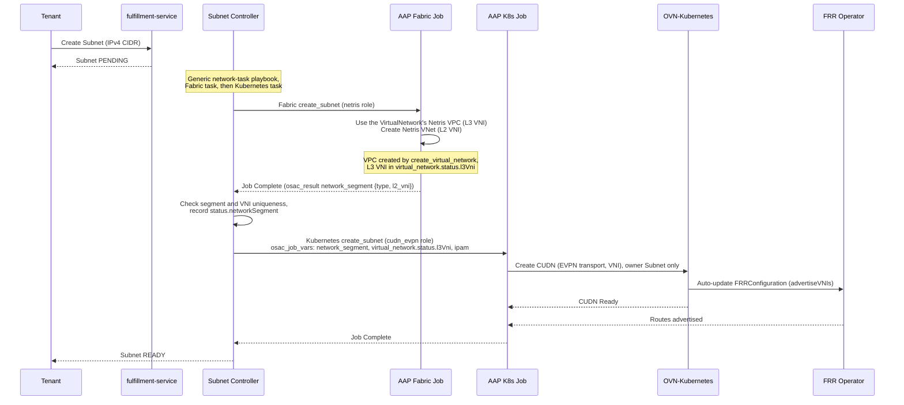

# CUDN EVPN K8s Manager Phase 1 Networking: Single-Cluster VM-to-Fabric Bridging

## Summary

This design adds the Kubernetes Manager `cudn_evpn` to OSAC-1433's NetworkClass two-manager architecture. It provisions an OVN-Kubernetes ClusterUserDefinedNetwork (CUDN) with EVPN transport, so KubeVirt VMs join the physical fabric through BGP EVPN. The design covers the fabric-to-Kubernetes data handoff, the CUDN lifecycle, the one-hub-network-per-VirtualNetwork limit, and tests. FRRConfiguration for BGP underlay peering is an installation prerequisite (not created by the manager); OVN-Kubernetes updates it when a CUDN appears. See [PRD](prd.md) for the requirements.

The data handoff from the Fabric Manager to `cudn_evpn` (the L3 and L2 VNIs, the address layout, the VM gateway, and the route targets) is the one [contract §4.8–§4.10](/enhancements/OSAC-1433-network-manager-integration-contract-networking/design.md#49-network-types-and-the-network-segment) defines; this design restates it where it uses it.

This manager inherits the [Unified Networking deployment support
boundary](/enhancements/OSAC-1433-unified-networking/design.md#deployment-support-boundary):
Phase 1 supports connected deployments only and does not add air-gapped or
disconnected networking support.
This manager also inherits the [Unified Networking hub support
boundary](/enhancements/OSAC-1433-unified-networking/design.md#networking-hub-support-boundary):
OSAC networking supports exactly one provider-owned hub per deployment.
Multi-hub networking placement, cross-hub resource coordination, and
cross-hub network connectivity are unsupported. This boundary applies only to
the networking area and does not define hub behavior for other OSAC areas.
Multiple hosting/workload clusters remain supported where a networking feature
explicitly specifies them.

## Related Designs

This design builds on and interacts with several networking designs:

- **OSAC-1435 VMaaS Networking** — VMs run in the VirtualNetwork's namespace `osac-vn-<VirtualNetwork API ID>`, which Kubernetes `apply_network_attachment` returns. VMs work on the Subnet that owns the hub network; a VM attachment on another Subnet fails with the `cudn_evpn` limit error ([contract §4.10](/enhancements/OSAC-1433-network-manager-integration-contract-networking/design.md#osac-kubernetes-manager-tasks-osac-internal)). VMaaS does not check this.
- **OSAC-1436 CaaS Networking** — CaaS clusters may run on EVPN-bridged subnets. Port-move primitive compatibility with EVPN transport (VXLAN encap vs VLAN trunking) is TBD (out of scope for Phase 1).
- **OSAC-1437 BMaaS Networking** — Bare-metal servers provisioned via `BareMetalNetworkAttachment` are L2/L3 peers of EVPN-bridged VMs. This design validates same-Subnet (L2) VM to bare-metal connectivity. Bare metal works on every Subnet; VM routing between Subnets waits for a later phase.
- **OSAC-1433 Default Networking** — Auto-provisioning of VN/Subnet/SG/NAT at tenant onboarding uses the deployment's one NetworkClass. `cudn_evpn` is the only Kubernetes Manager, so default networking uses it. Its prerequisites (VTEP, FRR, BGP underlay) are installation steps.
- **OSAC-2135 CaaS BM Worker Provisioning** — System-tenant bare-metal instances reference tenant Subnets. If those Subnets use `cudn_evpn`, the BMI provisioning flow interacts with the EVPN namespace/CUDN. Interaction is TBD (out of scope for Phase 1).
- **OSAC-1382 Multi-Fabric East-West** — Phase 1 east-west isolation domains will need to work across EVPN-bridged and non-EVPN subnets. Inter-domain routing with EVPN transport is TBD (out of scope for Phase 1).

## Motivation

OSAC runs VMs on OpenShift using KubeVirt. VM IP addresses exist only within the OVN overlay network and are not visible on the physical fabric. This prevents VMs from sharing L2 subnets with bare-metal servers or communicating across L3 subnets via shared ipVRF, blocking workloads that span VMs and bare-metal infrastructure.

The CUDN LocalNet approach (OSAC-1511) was frozen in favor of OVN EVPN, which provides better scalability and multi-cluster support (validated by OSAC-1717 spike). This design delivers single-cluster EVPN bridging as Phase 1, with a constraint that OVN-Kubernetes cannot currently route between separate CUDNs on the same cluster (Connectors feature pending).

**Implementation Context:**
A NetworkClass records a Fabric Manager and, optionally, a Kubernetes Manager. There is no dispatcher: the operator runs the recorded manager's role through the generic network-task playbook ([contract §4.3](/enhancements/OSAC-1433-network-manager-integration-contract-networking/design.md#43-invocation-settings-and-secrets)). This design adds `cudn_evpn`, the only Kubernetes Manager, and solves the fabric-to-k8s data dependency: the fabric manager allocates the VNIs, and `cudn_evpn` uses them to configure the CUDN. OSAC runs the Fabric task before the Kubernetes task ([contract §4.7](/enhancements/OSAC-1433-network-manager-integration-contract-networking/design.md#47-ordering-concurrency-retries-and-ownership)).

### Goals

- Reuse the NetworkClass two-manager architecture from OSAC-1433
- One hub network (CUDN) per VirtualNetwork, owned by one Subnet ([contract §4.10](/enhancements/OSAC-1433-network-manager-integration-contract-networking/design.md#osac-kubernetes-manager-tasks-osac-internal), `cudn_evpn` limit):
  - The owner Subnet's Kubernetes `create_subnet` creates the CUDN when the Subnet is created, not when a VM is
  - Other Subnets are accepted and go READY; bare metal works on them, and a VM attachment on them fails as final with the limit error
- K8s manager playbook creates CUDN as Kubernetes-native resource (no external API calls)
- FRRConfiguration for BGP underlay peering is installation prerequisite (auto-updated by OVN-Kubernetes, not by k8s manager)
- Installation prerequisites documented for Cloud Infrastructure Admin

### Non-Goals

- Multi-cluster VM placement (deferred to OSAC-3667 Phase 2)
- Inter-subnet L3 routing between VMs on same cluster (requires OVN Connectors)
- Multiple subnets per VirtualNetwork with multi-NIC VMs (deferred to Phase 2 when OVN-K supports secondary CUDNs — will enable VMs with multiple NICs, one per subnet)
- IPv6 or dual-stack support (Phase 1 is IPv4-only)
- A shared gateway MAC: OVN-Kubernetes and Netris serve `gateway_ipv4` with different MACs, which contract §4.9 accepts; a shared MAC is optional
- Automatic VTEP provisioning (manual prerequisite)

## Proposal

**Central Design Statement:**

Phase 1 extends a Netris VPC and its V-Nets into OpenShift. Each VirtualNetwork has one CUDN, owned by one Subnet. VMs work on the owner Subnet. A second Subnet is accepted and goes READY: bare metal works on it, and a VM on it fails with the `cudn_evpn` limit error ([contract §4.7](/enhancements/OSAC-1433-network-manager-integration-contract-networking/design.md#47-ordering-concurrency-retries-and-ownership)). VM routing between Subnets waits for a later phase.

This design introduces `cudn_evpn`, registered by an osac-installer ConfigMap and used when the NetworkClass declares `k8s_manager: "cudn_evpn"`.

**Resource Mapping:**

| OSAC Resource | Netris Resource | OVN-K Resource | Workloads |
|---------------|-----------------|----------------|-----------|
| VirtualNetwork | Netris VPC (L3 ipVRF) | Namespace `osac-vn-<VN API ID>` with baseline deny | — |
| Owner Subnet | Netris VNet (L2 macVRF) | CUDN `osac-vn-<VN API ID>` (primary) | VMs and bare metal |
| Other Subnets | Netris VNet (L2 macVRF) | — | Bare metal; VM attachments fail with the limit error |

- **One CUDN per VirtualNetwork:** OVN-Kubernetes needs a distinct IP-VRF VNI per network, and the fabric has one per VirtualNetwork
- **Multiple VNets per VPC:** all share the same IP-VRF
- **Owner:** the first Subnet whose Kubernetes `create_subnet` runs (in a tenant's default VirtualNetwork, the default Subnet). Its delete removes the CUDN, and the next Subnet created claims it

**Subnet provisioning sequence:**

0. **Fabric manager** (Netris) runs when the parent VirtualNetwork is created (`create_virtual_network`): creates the Netris VPC (IP-VRF) and returns its L3 VNI as `osac_result.l3_vni`. OSAC records it in the VirtualNetwork CR's `status.l3Vni` ([contract §4.9](/enhancements/OSAC-1433-network-manager-integration-contract-networking/design.md#49-network-types-and-the-network-segment)).
1. **Fabric manager** (Netris) runs when Subnet is created (`create_subnet`):
   - Uses the VPC of the parent VirtualNetwork, whose L3 VNI arrives in the stored parent snapshot as `virtual_network.status.l3Vni`
   - Creates Netris VNet for this Subnet (allocates L2 VNI)
   - Returns `osac_result.network_segment: {type: evpn, l2_vni}` (no `l3_vni`)
2. **Subnet controller** checks the segment and the VNI's uniqueness, records it in `Subnet.status.networkSegment` (`{type, l2Vni}`), and passes it to the Kubernetes tasks as the launch key `network_segment`
3. **K8s manager** (cudn_evpn) creates the CUDN when the VirtualNetwork has none (any other Subnet's `create_subnet` succeeds without changes):
   - `spec.network.evpn.macVRF = {vni: l2_vni, routeTarget: "0:<l2_vni>"}` (from `network_segment`)
   - `spec.network.evpn.ipVRF = {vni: l3_vni, routeTarget: "0:<l3_vni>"}` (from `virtual_network.status.l3Vni`)
   - `spec.network.layer2.defaultGatewayIPs = [ipam.gateway_ipv4]`: OVN-Kubernetes serves the VM gateway and routes into the IP-VRF (symmetric IRB)
   - `spec.network.layer2.infrastructureSubnets = [<gateway_ipv4>/32, <network + 2>/32]` (the gateway and OVN-Kubernetes' management port) and `reservedSubnets` = the fewest CIDRs covering the Subnet outside `ipam.overlay_ipv4_cidrs` and those two, so VMs get addresses only from the overlay range
   - `spec.network.layer2.mtu = 1500`
   - OVN-Kubernetes auto-updates FRRConfiguration when CUDN appears

Key resources:
- **VirtualNetwork** (fulfillment-service + osac-operator CRD): Fabric `create_virtual_network` creates the Netris VPC; its L3 VNI is recorded in `status.l3Vni`
- **NetworkClass** (fulfillment-service): extended with `k8s_manager` field (already exists)
- **Subnet** (fulfillment-service + osac-operator CRD): triggers fabric (VNet) and k8s (CUDN) provisioning; its L2 VNI is recorded in `status.networkSegment`
- **ClusterUserDefinedNetwork** (OVN-Kubernetes CRD): k8s manager creates with EVPN transport, macVRF/ipVRF VNI and explicit route targets `0:<VNI>`
- **FRRConfiguration** (FRR operator CRD): installation prerequisite (not created by k8s manager), auto-updated by OVN-Kubernetes when CUDN appears

### Workflow Description

**Actor:** Cloud Infrastructure Admin (prerequisite setup) and Tenant Admin (runtime usage)

**Starting State:**
- OCP cluster installed with OVN-Kubernetes, FRR operator, NMState operator
- VTEP CR exists (defines VTEP IPs for each worker node)
- BGP underlay configured (workers peer with fabric switches)
- NetworkClass exists with `fabric_manager: "netris"`, `k8s_manager: "cudn_evpn"`

**Runtime Flow:**



**Error Paths:**

- **Second Subnet:** accepted, and goes READY. A VM attachment on it fails as final with the `cudn_evpn` limit error; bare metal works on it ([contract §4.7](/enhancements/OSAC-1433-network-manager-integration-contract-networking/design.md#47-ordering-concurrency-retries-and-ownership)).
- **Subnet deletion when workloads exist:** the fulfillment service rejects it with `FAILED_PRECONDITION` ([Unified — Deletion dependency guards](/enhancements/OSAC-1433-unified-networking/design.md#deletion-dependency-guards)). Delete the workloads first.
- **Fabric job failure:** OSAC retries a retryable failure with backoff and starts no Kubernetes task until the Fabric task succeeds
- **Missing or malformed `network_segment`, or a VNI a live VirtualNetwork or Subnet holds:** OSAC rejects the result and marks Subnet as Failed ("VNI already in use" for a held VNI); a VNI held only by resources being deleted is retried with backoff ([contract §4.9](/enhancements/OSAC-1433-network-manager-integration-contract-networking/design.md#49-network-types-and-the-network-segment))
- **CUDN creation failure:** the Kubernetes task fails; a retryable failure keeps the Subnet PENDING while OSAC retries, a final one sets FAILED ([Unified — Status](/enhancements/OSAC-1433-unified-networking/design.md#status))

### API Extensions

**New:**
- osac-installer ConfigMap `osac-network-k8s-manager-cudn-evpn` (the `cudn_evpn` registration)
- osac-aap fabric manager role `netris` ([Netris Fabric Manager design](/enhancements/OSAC-2434-netris-fabric-manager-networking/design.md))
- osac-aap k8s manager role `cudn_evpn` (creates the namespace, the CUDN, and the SecurityGroup policies)

**Modified:** none. The operator runs every task through the generic network-task playbook in contract order ([contract §4.3](/enhancements/OSAC-1433-network-manager-integration-contract-networking/design.md#43-invocation-settings-and-secrets), [contract §4.7](/enhancements/OSAC-1433-network-manager-integration-contract-networking/design.md#47-ordering-concurrency-retries-and-ownership)); `cudn_evpn` adds no operator, VMaaS, or fulfillment-service code and no proto change.

**External CRDs Used (not created by OSAC):**
- `ClusterUserDefinedNetwork` (k8s.ovn.org/v1, OVN-Kubernetes) — created by k8s manager
- `FRRConfiguration` (frrk8s.metallb.io/v1beta1, FRR operator) — installation prerequisite, auto-updated by OVN-Kubernetes when CUDN appears
- `VTEP` (k8s.ovn.org/v1, OVN-Kubernetes) — prerequisite, not created by k8s manager

## UX Alignment

*Skip this section — no `osac-ux` temp-api file exists for NetworkClass or Subnet (backend-only feature).*

### Implementation Details/Notes/Constraints

#### Ordering and the hub-network limit

- **Order:** for a VirtualNetwork or Subnet, the Fabric task runs before the Kubernetes task, and delete runs in reverse; a VM attachment applies on Kubernetes first ([contract §4.7](/enhancements/OSAC-1433-network-manager-integration-contract-networking/design.md#47-ordering-concurrency-retries-and-ownership)).
- **Data path:** the Fabric job publishes `osac_result` (`l3_vni` from `create_virtual_network`, `network_segment` from `create_subnet`). OSAC validates it, checks VNI uniqueness, and records it in `VirtualNetwork.status.l3Vni` and `Subnet.status.networkSegment`. The Kubernetes job gets `network_segment` as a launch key and the L3 VNI in the stored `virtual_network` snapshot ([contract §4.9](/enhancements/OSAC-1433-network-manager-integration-contract-networking/design.md#49-network-types-and-the-network-segment)).
- **Limit:** a non-owner Subnet's Kubernetes `create_subnet` succeeds without changes. Its VM `apply_network_attachment` fails with `retryable: false` and a message that starts "cudn_evpn implementation limit"; its delete succeeds. Neither the fulfillment service nor VMaaS checks the limit ([contract §4.7](/enhancements/OSAC-1433-network-manager-integration-contract-networking/design.md#47-ordering-concurrency-retries-and-ownership), [contract §4.10](/enhancements/OSAC-1433-network-manager-integration-contract-networking/design.md#osac-kubernetes-manager-tasks-osac-internal)).
- **Claim while the owner is deleted:** a `create_subnet` that finds the CUDN owned by a Subnet being deleted fails with `retryable: true`, so it claims the CUDN once the owner's delete finishes ([contract edge case](/enhancements/OSAC-1433-network-manager-integration-contract-networking/design.md#kubernetes-manager-hub-network)).
- **Status:** each CR has one `Ready` condition and `status.jobs` ([Unified — Status](/enhancements/OSAC-1433-unified-networking/design.md#status)).

#### osac-aap: netris Fabric Manager Role

The [Netris Fabric Manager design](/enhancements/OSAC-2434-netris-fabric-manager-networking/design.md) specifies the `netris` role. `cudn_evpn` needs only this from the Fabric ([contract §4.9](/enhancements/OSAC-1433-network-manager-integration-contract-networking/design.md#49-network-types-and-the-network-segment)):
- **VNIs:** `create_virtual_network` returns the VPC VNI as `l3_vni`; `create_subnet` returns the V-Net VXLAN ID as `network_segment: {type: evpn, l2_vni}`. Netris allocates both; there is no OSAC VNI range.
- **Route targets:** both sides use `0:<VNI>` (`0:<l2_vni>` on the MAC-VRF, `0:<l3_vni>` on the IP-VRF). OSAC passes no route target.
- **Gateway:** OVN-Kubernetes serves `gateway_ipv4` to VMs. The Netris V-Net also serves `gateway_ipv4` (`.1`) with Netris's own MAC, so bare metal has a local gateway. Two gateway MACs are accepted; a shared MAC is optional ([Netris — Gateway and DHCP](/enhancements/OSAC-2434-netris-fabric-manager-networking/design.md#gateway-and-dhcp)).
- **DHCP:** Netris DHCP over `physical_ipv4_cidrs` is on from `create_subnet`. VMs never reach it: OVN-Kubernetes answers their DHCP inside the logical switch.
- **Physical attachments:** OSAC runs one physical attachment task at a time per Fabric Manager ([contract §4.7](/enhancements/OSAC-1433-network-manager-integration-contract-networking/design.md#47-ordering-concurrency-retries-and-ownership)).
- **SecurityGroups:** the Netris SecurityGroup tasks are no-ops; `cudn_evpn` enforces SecurityGroups for VMs with NetworkPolicy.

#### osac-aap: cudn_evpn K8s Manager Role

**Role Structure:**

```
collections/ansible_collections/osac/templates/roles/cudn_evpn/
├── tasks/
│   ├── create_virtual_network.yaml  # Namespace
│   ├── delete_virtual_network.yaml
│   ├── create_subnet.yaml           # CUDN of the owner Subnet; no FRR object
│   ├── delete_subnet.yaml           # Delete the CUDN this Subnet owns
│   ├── create_security_group.yaml   # NetworkPolicy
│   ├── delete_security_group.yaml
│   ├── apply_network_attachment.yaml  # Bind the VM to its SecurityGroups
│   └── delete_network_attachment.yaml
```

The role has no capability file. The registration ConfigMap declares the manager ([contract §4.2](/enhancements/OSAC-1433-network-manager-integration-contract-networking/design.md#42-registration-and-capabilities); see osac-installer: K8s Manager Registration below).

**tasks/create_subnet.yaml:**

```yaml
---
- name: Validate the network segment and the VirtualNetwork's L3 VNI
  ansible.builtin.assert:
    that:
      - osac_job_vars.network_segment.keys() | sort == ['l2_vni', 'type']
      - osac_job_vars.network_segment.type == 'evpn'
      - osac_job_vars.virtual_network.status.l3Vni is defined
      - osac_job_vars.network_segment.l2_vni != osac_job_vars.virtual_network.status.l3Vni
    fail_msg: "cudn_evpn received an invalid task input"   # retryable: false (an input OSAC never sends)

- name: Extract VNI values and the address layout
  ansible.builtin.set_fact:
    l2_vni: "{{ osac_job_vars.network_segment.l2_vni }}"            # launch key network_segment {type, l2_vni}
    l3_vni: "{{ osac_job_vars.virtual_network.status.l3Vni }}"      # stored parent snapshot
    gateway_ipv4: "{{ osac_job_vars.ipam.gateway_ipv4 }}"
    management_port_ipv4: "{{ osac_job_vars.resource.spec.ipv4Cidr | ansible.utils.ipmath(2) }}"   # network + 2
    # The fewest CIDRs covering the Subnet outside ipam.overlay_ipv4_cidrs, gateway_ipv4/32 and
    # <network + 2>/32, computed by the role's filter plugin (at most 25, else retryable: false)
    reserved_subnets: "{{ (osac_job_vars | osac.templates.cudn_evpn_plan).cudn_manifest.spec.network.layer2.reservedSubnets | default([]) }}"
    subnet_cidr: "{{ osac_job_vars.resource.spec.ipv4Cidr }}"
    subnet_id: "{{ osac_job_vars.resource.id }}"
    vn_id: "{{ osac_job_vars.virtual_network.id }}"
    tenant_id: "{{ osac_job_vars.tenant }}"
    hub_name: "osac-vn-{{ osac_job_vars.virtual_network.id }}"  # the VirtualNetwork's namespace and CUDN name

# The namespace osac-vn-<VN API ID> and its baseline deny come from Kubernetes
# create_virtual_network; create_subnet creates no namespace.

# Claim: when the CUDN exists and its owner-subnet is another Subnet, end here
# with no change. When that owner is being deleted, fail with retryable: true.

- name: Create ClusterUserDefinedNetwork
  kubernetes.core.k8s:
    state: present
    definition:
      apiVersion: k8s.ovn.org/v1
      kind: ClusterUserDefinedNetwork
      metadata:
        name: "{{ hub_name }}"
        labels:
          evpn: "true"  # Picked up by RouteAdvertisements
          osac.openshift.io/virtualnetwork-id: "{{ vn_id }}"
          osac.openshift.io/tenant: "{{ tenant_id }}"
          osac.openshift.io/owner-kind: subnet          # owner labels (contract §4.3)
          osac.openshift.io/owner-id: "{{ subnet_id }}"
        annotations:
          osac.openshift.io/tenant: "{{ tenant_id }}"
          osac.openshift.io/owner-subnet: "{{ subnet_id }}"   # the Subnet that owns the hub network
      spec:
        namespaceSelector:
          matchLabels:
            osac.openshift.io/virtualnetwork-id: "{{ vn_id }}"  # the VirtualNetwork's namespace
            osac.openshift.io/tenant: "{{ tenant_id }}"
        network:
          topology: Layer2
          transport: EVPN
          layer2:
            role: Primary
            subnets:
              - "{{ subnet_cidr }}"
            mtu: 1500
            defaultGatewayIPs:
              - "{{ gateway_ipv4 }}"           # OVN-Kubernetes serves the VM gateway (symmetric IRB into the IP-VRF)
            infrastructureSubnets:            # the gateway and OVN-Kubernetes' management port (network + 2)
              - "{{ gateway_ipv4 }}/32"
              - "{{ management_port_ipv4 }}/32"
            reservedSubnets: "{{ reserved_subnets }}"   # the role omits the key when the list is empty; VMs get only overlay addresses
            ipam:
              mode: Enabled
              lifecycle: Persistent           # VMs keep their address across restart and live migration
          evpn:
            vtep: tenant-vtep  # Cluster-wide singleton VTEP
            macVRF:
              vni: "{{ l2_vni | int }}"
              routeTarget: "0:{{ l2_vni }}"
            ipVRF:
              vni: "{{ l3_vni | int }}"
              routeTarget: "0:{{ l3_vni }}"

- name: Wait until the CUDN is ready
  kubernetes.core.k8s_info:
    api_version: k8s.ovn.org/v1
    kind: ClusterUserDefinedNetwork
    name: "{{ hub_name }}"
  register: cudn_status
  # OVN-Kubernetes 4.22 sets no Ready condition: wait for these three to be True
  until: >-
    cudn_status.resources[0].status.conditions | default([])
    | selectattr('type', 'in', ['TransportAccepted', 'NetworkCreated', 'NetworkAllocationSucceeded'])
    | selectattr('status', 'equalto', 'True') | list | length == 3
  retries: 30
  delay: 10
# Kubernetes create_subnet publishes no osac_result (contract §4.10)
```

**Rationale:**
- **Namespace and CUDN name = `osac-vn-<VirtualNetwork API ID>`**: one namespace per VirtualNetwork (from Kubernetes `create_virtual_network`) and one CUDN per VirtualNetwork, owned by one Subnet (contract §4.10, `cudn_evpn` limit)
- CUDN namespaceSelector matches by `osac.openshift.io/virtualnetwork-id` and `osac.openshift.io/tenant`
- Namespace label `k8s.ovn.org/primary-user-defined-network` required for UDN as primary network (set at namespace creation)
- VTEP reference = `tenant-vtep` (cluster singleton, installation prerequisite)
- VNI values: L2 (macVRF) from the launch key `network_segment.l2_vni`, L3 (ipVRF) from the stored parent snapshot `virtual_network.status.l3Vni` (contract §4.9)
- Route targets explicit: `0:<l2_vni>` on macVRF, `0:<l3_vni>` on ipVRF, the same values the Fabric imports and exports; they do not depend on the node AS, so every 24-bit VNI is usable
- Wait for the CUDN's `TransportAccepted`, `NetworkCreated` and `NetworkAllocationSucceeded` conditions before completing (prevents race with VM provisioning)
- **Addressing from `ipam`** (contract §4.8): `infrastructureSubnets` = `[<gateway_ipv4>/32, <network + 2>/32]` and `reservedSubnets` = the rest of the Subnet outside the overlay range, so OVN IPAM never hands out a fabric, LB VIP, gateway or management-port address; a layout needing more than 25 `reservedSubnets` entries fails as final
- `defaultGatewayIPs: [gateway_ipv4]` — OVN-Kubernetes serves the VM gateway and routes into the IP-VRF; MTU 1500
- [Demo: Phase 5.2 CUDN structure] [Research: §Existing Solutions — OVN-K CUDN]

**tasks/delete_subnet.yaml:**

```yaml
---
# OSAC runs this after every overlay attachment on the Subnet is deleted; the fulfillment
# service rejects a Subnet delete while a workload references it.

# Only the owner Subnet removes the hub network; any other Subnet changes nothing.
# The namespace osac-vn-<VN ID>, its baseline deny and the SecurityGroup policies stay
# until Kubernetes delete_virtual_network / delete_security_group.

- name: Extract resource identifiers
  ansible.builtin.set_fact:
    subnet_id: "{{ osac_job_vars.resource.id }}"
    vn_id: "{{ osac_job_vars.virtual_network.id }}"
    tenant_id: "{{ osac_job_vars.tenant }}"
    hub_name: "osac-vn-{{ osac_job_vars.virtual_network.id }}"  # the VirtualNetwork's CUDN name

- name: Read the VirtualNetwork's hub network
  kubernetes.core.k8s_info:
    api_version: k8s.ovn.org/v1
    kind: ClusterUserDefinedNetwork
    name: "{{ hub_name }}"
  register: cudn_live

- name: Delete the hub network this Subnet owns
  vars:
    _meta: "{{ (cudn_live.resources | first | default({})).metadata | default({}) }}"
  when:
    - cudn_live.resources | length > 0
    - (_meta.labels | default({}))['osac.openshift.io/virtualnetwork-id'] | default('') == vn_id
    - (_meta.labels | default({}))['osac.openshift.io/tenant'] | default('') == tenant_id
    - (_meta.annotations | default({}))['osac.openshift.io/owner-subnet'] | default('') == subnet_id
  kubernetes.core.k8s:
    api_version: k8s.ovn.org/v1
    kind: ClusterUserDefinedNetwork
    name: "{{ hub_name }}"
    state: absent
    wait: true   # wait until it is gone (not just deletionTimestamp set)
  # Waiting for full deletion ensures OVN has released the VNIs before the
  # Fabric delete_subnet frees the L2 VNI (Kubernetes delete runs first)
```

**Delete order** ([contract §4.7](/enhancements/OSAC-1433-network-manager-integration-contract-networking/design.md#47-ordering-concurrency-retries-and-ownership), [Unified — Deletion dependency guards](/enhancements/OSAC-1433-unified-networking/design.md#deletion-dependency-guards)):
- The fulfillment service rejects a Subnet delete while a workload references the Subnet, and a VirtualNetwork delete while any of its Subnets exists. The operator checks no VMs or namespaces.
- Subnet: Kubernetes `delete_subnet` runs first. Only the owner Subnet removes the CUDN, and it waits until the CUDN is gone, so OVN-Kubernetes has released the VNIs before the Fabric `delete_subnet` frees the L2 VNI. For any other Subnet it changes nothing. Existing Subnets do not take over the hub network; the next Subnet created claims it ([contract §4.10](/enhancements/OSAC-1433-network-manager-integration-contract-networking/design.md#osac-kubernetes-manager-tasks-osac-internal)).
- VirtualNetwork: Kubernetes `delete_virtual_network` removes the namespace `osac-vn-<VirtualNetwork API ID>` and its baseline deny; then the Fabric delete removes the VPC.
- A failed delete keeps the finalizer and is retried.
- Stale VRF recovery is manual (Support Procedures): an ovnkube-node restart affects all VMs on the node.

**FRRConfiguration Handling:**

FRRConfiguration for underlay BGP peering is created during installation (manual prerequisite). The k8s manager does **not** create or modify FRRConfiguration. OVN-Kubernetes auto-updates FRR config when CUDN with `evpn: "true"` label is created.

Per demo Phase 5.3:
> "On CUDN creation, BGP FRR configuration is updated... advertise-all-vni"

The RouteAdvertisements CR (installation prerequisite) defines `frrConfigurationSelector: {matchLabels: {evpn: "true"}}`, which tells OVN-K to update any FRRConfiguration with that label when a CUDN with matching label appears.

**Assumption:** Installation-time FRRConfiguration exists in `openshift-frr-k8s` namespace with label `evpn: "true"`. K8s manager only creates CUDN; FRR integration is declarative via label matching.

[Demo: Phase 2.6 FRRConfiguration, Phase 2.5 RouteAdvertisements] [Research: §FRR Operator — advertiseVNIs]

**DHCP Coexistence:**

Both Netris and OVN run DHCP servers for the same subnet:
- **Netris DHCP:** On from the creation of the Subnet's V-Net, over `ipam.physical_ipv4_cidrs` only
- **OVN DHCP:** Runs inside the logical switch for the CUDN subnet

**Behavior:**
OVN answers DHCP requests inside the logical switch, so they never reach the fabric. VMs receive IP addresses from OVN DHCP and never see Netris DHCP offers (TC-R6-01, step 8).

**IP allocation strategy (REQUIRED for correctness):**
- Both managers get the Subnet's address layout in `osac_job_vars.ipam` ([contract §4.8](/enhancements/OSAC-1433-network-manager-integration-contract-networking/design.md#48-addressing)); the Fabric Manager returns no reserved range
- `reservedSubnets` covers the Subnet outside `ipam.overlay_ipv4_cidrs` (the fabric DHCP and LB VIP ranges), and `infrastructureSubnets` holds `gateway_ipv4/32` and `<network + 2>/32` (OVN-Kubernetes' management port), so OVN IPAM never allocates an address the fabric or OVN-Kubernetes uses
- Netris DHCP hands out only addresses from `ipam.physical_ipv4_cidrs`, never an overlay address; it cannot filter by MAC, but VM requests never reach it

**Operational notes:**
- Netris DHCP stays enabled — it serves bare-metal nodes on the fabric
- OVN DHCP serves only VMs in the CUDN namespace; their requests do not reach Netris DHCP

[Earlier demo, Netris DHCP enabled on the whole V-Net: the VM received its IP from OVN.]

**Gateway Ownership (Critical Architecture Decision):**

OVN-Kubernetes serves the VM gateway ([contract §4.9](/enhancements/OSAC-1433-network-manager-integration-contract-networking/design.md#49-network-types-and-the-network-segment)):

**What happens:**
1. `cudn_evpn` sets `layer2.defaultGatewayIPs: [ipam.gateway_ipv4]` (the Subnet's network address + 1, e.g., 200.200.1.1)
2. OVN DHCP gives VMs that address as router
3. OVN-Kubernetes serves the gateway address and routes the VM's L3 traffic into the IP-VRF (symmetric integrated routing and bridging, ipVRF VNI = `l3_vni`)
4. Traffic to other Subnets and outside the VirtualNetwork is encapsulated (VXLAN) with the L3 VNI toward the fabric, which routes the IP-VRF
5. Same-subnet traffic to bare-metal hosts is bridged over the macVRF (L2 VNI)

**Phase 1 behavior:**
- `defaultGatewayIPs: [gateway_ipv4]` and `infrastructureSubnets` include the gateway, so OVN IPAM never hands it to a VM
- The fabric (Netris) carries the macVRF and ipVRF and routes the ipVRF. It may also serve `gateway_ipv4` on its devices ([contract §4.9](/enhancements/OSAC-1433-network-manager-integration-contract-networking/design.md#49-network-types-and-the-network-segment)). The Netris manager does: its V-Net serves `gateway_ipv4` on its anycast gateway, as the working lab spike does, and OVN-Kubernetes serves the same address. OVN-Kubernetes assigns VM addresses; Netris DHCP serves only `physical_ipv4_cidrs`, for physical attachments.
- Same-Subnet L2 traffic (VM to VM, VM to bare metal on one V-Net) is verified in the lab, as are NAT egress and ExternalIP ingress through the gateway; inter-Subnet routed traffic is not yet verified. Routed traffic can see two gateway MACs, because the two sides do not share the gateway MAC; contract §4.9 accepts this. A shared MAC is optional: the Netris V-Net `customAnycastMac` set to OVN-Kubernetes' fixed gateway MAC, `0a:58` followed by the four bytes of `gateway_ipv4` (research evidence; not tested in the lab)
- Route targets `0:<l2_vni>` (macVRF) and `0:<l3_vni>` (ipVRF) on both sides
- Physical hosts on the Subnet use the Netris gateway on `gateway_ipv4` (`.1`) with Netris's own MAC ([Netris — Gateway and DHCP](/enhancements/OSAC-2434-netris-fabric-manager-networking/design.md#gateway-and-dhcp))

**History:** an earlier demo omitted `defaultGatewayIPs` and let a Netris SVI own `.1` (no OVN logical router port). That gateway model is superseded by the contract.

#### Lab probe results (Netris)

The Netris lab probe of 2026-10-29 (IPAM 172.16.0.0/24) gave these results. The probe V-Nets had no member ports.

- Netris assigned a VPC VNI (11) and V-Net VXLAN IDs (14 without a gateway, 17 with one), present in the response right after the create. An explicit `vxlanID` was honoured and read back.
- None of the VNIs or the probe VPC's VRF appeared on any leaf or SoftGate, with or without a gateway. Netris deploys a V-Net and its VRF only where a member port exists (interpretation). Routed traffic needs the VPC VRF. Same-Subnet traffic does not.
- The Netris API has no route-target field. The leaves use `<ASN>:<VNI>` automatically. The SoftGates import and export `0:<VNI>`, the same as `cudn_evpn`. Routed traffic that depends on the leaves importing `0:<VNI>` is not yet verified. NAT egress and ExternalIP ingress over Netris pass in the lab (2026-11-01), with the IPAM objects outside the VPC and the rules inside it. They need the common subnet around the NAT `/32` addresses, which the manager creates with the ExternalIPPool. A NAT task is READY when Netris accepted the configuration, not when traffic flows; an optional route-target field in the Fabric result is a follow-up.
- Netris reserves its private IP allocation (by default `10.0.0.0/8`), so the lab adds it to `excludedIpv4Cidrs`; tenant networks use another private range such as `172.16.0.0/12`.
- Names of 44 characters were accepted for the VPC and V-Net. 47 characters (`osac-natgw-<uuid>`) are not tested.

#### osac-installer: K8s Manager Registration

**New ConfigMap:**

```yaml
apiVersion: v1
kind: ConfigMap
metadata:
  name: osac-network-k8s-manager-cudn-evpn
  namespace: osac
  labels:
    osac.openshift.io/network-k8s-manager: "true"  # Matches OSAC-1433 label path
immutable: true
data:
  name: cudn_evpn  # Field name 'name' per OSAC-1433 schema (not 'manager')
  ansible_role: osac.templates.cudn_evpn
  network_type: evpn
  # No `capabilities` key: IPv4 is mandatory and is not a capability, and
  # cudn_evpn does not declare security_group_icmp (a NetworkPolicy cannot
  # match ICMP).
```

**Capability Fields:**
- The registration declares no capability. In particular it does not declare
  `security_group_icmp`, so a NetworkClass with `cudn_evpn` always has
  `status.security_group_icmp` false and the API rejects ICMP rules.
- IPv6 and dual-stack are not supported; IPv4 is not a capability token.
- The one-hub-network-per-VirtualNetwork limit is not a capability token. The
  fulfillment service does not check it: VMs work only on the Subnet that owns
  the hub network, and a VM attachment on any other Subnet fails as final with
  an error that names the limit ([contract §4.7](/enhancements/OSAC-1433-network-manager-integration-contract-networking/design.md#47-ordering-concurrency-retries-and-ownership)).

**RBAC:**

```yaml
apiVersion: rbac.authorization.k8s.io/v1
kind: ClusterRole
metadata:
  name: osac-aap-cudn-evpn
rules:
- apiGroups: ["k8s.ovn.org"]
  resources: ["clusteruserdefinednetworks"]
  verbs: ["create", "get", "list", "watch", "update", "patch", "delete"]
- apiGroups: ["k8s.ovn.org"]
  resources: ["vteps"]
  verbs: ["get", "list"]  # Read-only, VTEP is prerequisite
---
apiVersion: rbac.authorization.k8s.io/v1
kind: ClusterRoleBinding
metadata:
  name: osac-aap-cudn-evpn
roleRef:
  apiGroup: rbac.authorization.k8s.io
  kind: ClusterRole
  name: osac-aap-cudn-evpn
subjects:
- kind: ServiceAccount
  name: osac-aap-runner  # AAP job execution SA
  namespace: osac
```

**Rationale:**
- ConfigMap registration follows contract §4.2
- RBAC grants CUDN create/delete, VTEP read-only
- No FRRConfiguration RBAC needed (not created by k8s manager)
- [Codebase: osac/osac-installer/charts/osac/templates/k8s-manager-*.yaml]


### Security Considerations

**Tenant Isolation:**

All OSAC resources include standard tenant isolation metadata:
- `osac.openshift.io/tenant` annotation on CUDN and namespace
- Owner labels `osac.openshift.io/owner-kind: subnet` and `osac.openshift.io/owner-id: <owner Subnet API ID>` on the CUDN (contract §4.3), and the annotation `osac.openshift.io/owner-subnet` with the same ID
- OPA policies enforce read/write isolation at fulfillment-service API layer

**New Isolation Boundary:**

CUDN namespace selector uses `matchLabels: {osac.openshift.io/virtualnetwork-id: "<VN ID>", osac.openshift.io/tenant: "<tenant>"}`. Phase 1: each VirtualNetwork has one namespace and one CUDN. VMs in different VirtualNetworks cannot communicate at L2 or L3 (separate macVRF + ipVRF).

**Node reachability:**

OVN-Kubernetes treats every EVPN network as advertised and SNATs traffic toward the cluster node IPs to the network's management-port masquerade IP, so it reaches the host through the management port, inside the network's VRF. A VM whose SecurityGroup allows all egress can therefore ping the node that hosts it. Measured on the single-node lab: TCP to listening ports got a reset from the node kernel, consistent with `net.ipv4.tcp_l3mdev_accept=0`, and traffic beyond the node stopped at the VRF's `unreachable` default. A listening UDP service got port-unreachable, consistent with `net.ipv4.udp_l3mdev_accept=0`. Isolation of node services rests on those kernel defaults. Another node's address has not been measured, and no E2E checks this.

**BGP Security:**

Underlay BGP session (OCP ↔ fabric switch) uses MD5 authentication (configured during installation, not managed by OSAC). FRRConfiguration credentials stored in Kubernetes Secret.

**No New Attack Surface:**

- CUDN and FRRConfiguration are cluster-scoped CRDs, not tenant-facing APIs
- Tenants interact only via fulfillment-service Subnet API (existing auth/authz)
- AAP jobs run with service account (RBAC-controlled), not tenant credentials

**Input Validation:**

VNI values from fabric manager are integers from 1 to 16777215, validated by OSAC before it records them (contract §4.9) and again by the CUDN CRD schema. Route targets are the strings `0:<VNI>` that `cudn_evpn` builds. Subnet CIDR validated by fulfillment-service (existing validation).

### Failure Handling and Recovery

**Fabric Job Failure:**

- **What happens:** Netris API error, VNet already exists, quota exceeded
- **Recovery:** OSAC retries a retryable failure with backoff (contract §4.7)
- **User observes:** while OSAC retries, the Subnet stays `Ready=False`, reason `Progressing` (API PENDING); a final error sets reason `Failed` (API FAILED). The `status.jobs` entry holds the job message

**Invalid Fabric Result:**

- **What happens:** Fabric job succeeds but its `osac_result` lacks `l3_vni` (VirtualNetwork) or `network_segment` (Subnet), has a string or out-of-range VNI, an extra key (for example `l3_vni` from `create_subnet`), or a value that differs from the recorded one
- **Recovery:** OSAC rejects the result ([contract §4.9](/enhancements/OSAC-1433-network-manager-integration-contract-networking/design.md#49-network-types-and-the-network-segment)) and marks the resource Failed; the recorded value, if any, stays
- **User observes:** The status message names the broken rule; delete and recreate the resource

**K8s Job Failure:**

- **What happens:** CUDN creation rejected (VNI collision, VTEP not found, invalid route target)
- **Recovery:** OSAC retries a retryable failure with backoff (contract §4.7)
- **User observes:** as for a Fabric job failure; the `status.jobs` entry message and the AAP job log show the CUDN API error

**CUDN VNI Collision:**

- **What happens:** The Fabric returns a VNI that another VirtualNetwork's `status.l3Vni` or another Subnet's `status.networkSegment.l2Vni` holds
- **Recovery:** OSAC accepts L3 and L2 VNIs one at a time under one operator-wide lock, reading VirtualNetwork and Subnet CRs from the API server ([contract §4.9](/enhancements/OSAC-1433-network-manager-integration-contract-networking/design.md#49-network-types-and-the-network-segment)). A VNI held by a live resource fails the create as final; a VNI held only by resources being deleted puts the create in `Retrying` with backoff, and the idempotent rerun is checked again
- **Mitigation:** Netris must still guarantee VNI uniqueness and reuse a VNI only after the Fabric delete that held it succeeded
- **User observes:** The resource fails with "VNI already in use" (no VNI or other resource ID in the message)

**Controller Restart Mid-Reconciliation:**

- **What happens:** Controller crashes after fabric job completes, before k8s job starts
- **Recovery:** Idempotent reconciliation — controller re-reads Subnet status, detects fabric job complete, proceeds to k8s job
- **User observes:** No impact, reconciliation resumes

**Partial Cleanup (Delete Subnet):**

- **What happens:** CUDN deleted but Netris VNet delete fails
- **Recovery:** Finalizer blocks Subnet deletion until Netris cleanup succeeds
- **User observes:** Subnet stuck in "Terminating" state, check fabric manager logs

**OVN-K CUDN Not Ready:**

- **What happens:** CUDN created but OVN-K cannot provision (namespace missing, VTEP down)
- **Recovery:** the playbook waits for the CUDN conditions `TransportAccepted`, `NetworkCreated` and `NetworkAllocationSucceeded` (30 retries × 10s = 5 min), then fails the task with `retryable: true`; OSAC retries with backoff
- **User observes:** the Subnet stays PENDING (`Ready=False`, `Progressing`); the `status.jobs` entry message names the wait. Check the OVN-K logs

### RBAC / Tenancy

**Tenant Isolation Enforced:**

- fulfillment-service API: OPA policies filter Subnet list/get by `osac.openshift.io/tenant` annotation
- CUDN and namespace: labeled with `osac.openshift.io/tenant` for traceability (not enforced by K8s RBAC — cluster-scoped CRDs are admin-only)
- VMs: run in the VirtualNetwork's namespace `osac-vn-<VirtualNetwork API ID>`; SecurityGroups restrict them with NetworkPolicy

**No RBAC Changes:**

Existing RBAC model applies. Tenant users interact via fulfillment-service API (gRPC/REST). CUDN and FRRConfiguration are cluster-scoped, created by AAP service account, not directly accessible to tenants.

**Owner Reference Annotations:**

- CUDN labels `osac.openshift.io/owner-kind: subnet` and `osac.openshift.io/owner-id: <owner Subnet API ID>` (contract §4.3), plus the annotation `osac.openshift.io/owner-subnet`
- Cleanup finds the CUDN by owner: only the owner Subnet's Kubernetes `delete_subnet` removes it

### Observability and Monitoring

`cudn_evpn` adds no metrics, events, or alerts. Use each CR's `Ready` condition ([Unified — Status](/enhancements/OSAC-1433-unified-networking/design.md#status)), its `status.jobs` entries ([contract §4.7](/enhancements/OSAC-1433-network-manager-integration-contract-networking/design.md#47-ordering-concurrency-retries-and-ownership)), and the AAP job logs.

### Risks and Mitigations

| Risk | Mitigation |
|------|------------|
| **VNI allocation race condition** — two Subnets created simultaneously get same VNI | Fabric manager (Netris) guarantees cluster-wide VNI uniqueness atomically. OSAC also checks every accepted VNI against all VirtualNetwork and Subnet CRs under one lock: a VNI a live resource holds is rejected, one held only by resources being deleted is retried. VNI reuse during delete+recreate: fabric deprovision only after CUDN fully deleted (not just deletionTimestamp set) |
| **Two gateway MACs** — OVN-Kubernetes and Netris serve `gateway_ipv4` with different MACs | Accepted by contract §4.9 and stated in the Netris design; same-Subnet traffic does not depend on it. A shared MAC is optional |
| **VTEP not created** — k8s manager assumes VTEP exists, CUDN creation fails | Kubernetes `create_subnet` fails with `retryable: true` while a hub prerequisite is missing, so the admin can add it (contract §4.10) |
| **Fabric output data loss** — fabric job completes but OSAC does not process its result | OSAC records the accepted VNIs in CR status (`VirtualNetwork.status.l3Vni`, `Subnet.status.networkSegment`) in the same status update that marks the Fabric task `Succeeded`; after a restart it resolves the job by its AAP label and processes the result (contract §4.7). |
| **IPv4-only regression** — future IPv6 support breaks existing CUDNs | CUDN VNI is immutable (delete+recreate required), no in-place upgrade |
| **FRRConfiguration conflict** — multiple OSAC installations on same cluster, label collision | Installation guide warns against multi-instance deployments, OR use namespace-scoped FRRConfiguration selector |
| **Dual DHCP confusion** — both fabric and OVN run DHCP, unclear which serves VMs | Expected behavior: OVN intercepts DHCP inside the logical switch, so VM requests never reach fabric DHCP. Netris range DHCP answers any MAC in `physical_ipv4_cidrs`, but only hosts on fabric ports reach it (TC-R6-01, step 8). |
| **cudn_evpn coupled to Netris-specific outputs** — k8s manager expects Netris VPC/VNet concepts, won't work with other fabric managers | Generic contract ([contract §4.9](/enhancements/OSAC-1433-network-manager-integration-contract-networking/design.md#49-network-types-and-the-network-segment)): `l3_vni` from `create_virtual_network`, `network_segment: {type, l2_vni}` from `create_subnet`, and the `ipam` layout. Any fabric manager (OpenStack Neutron, Cisco ACI, Netris) can provide this contract without k8s manager changes. Netris role is first implementation of the contract. |

### Drawbacks

**Manual Prerequisites:**

Cloud Infrastructure Admin must configure VTEP, FRRConfiguration, and BGP underlay before tenants can use this feature. High operational complexity compared to CUDN LocalNet (which required only nmstate, no BGP).

**Trade-off justification:** EVPN scalability (millions of VNIs vs 4096 VLANs) and multi-cluster support (Phase 2) outweigh the installation burden for large deployments.

**Hub-Network Limit:**

Only the Subnet that owns the hub network runs VMs. Other Subnets are accepted and go READY; bare metal works on them, and a VM attachment on them fails as final with the `cudn_evpn` limit error.

**Trade-off justification:** OVN Connectors (inter-subnet routing) and OVN-K secondary CUDN support (multi-NIC VMs) are pending. Phase 1 delivers single-cluster EVPN bridging with one CUDN per VirtualNetwork. Phase 2 will enable: (1) OVN Connectors for inter-subnet routing between VMs, (2) OVN-K secondary CUDN support for multi-NIC VMs (one NIC per subnet).

**Sequential Provisioning Latency:**

Subnet provisioning takes 2× the time of parallel provisioning (fabric job + k8s job serially instead of concurrently).

**Trade-off justification:** Data dependency requires sequencing. Measured overhead: ~30s fabric job + ~20s k8s job = ~50s total (vs ~30s parallel). Acceptable for infrequent Subnet creates.

## Alternatives (Not Implemented)

### Alternative 1: Unified AAP Workflow Template

**Approach:** One AAP workflow runs the Netris role, passes the VNIs through `set_stats`, and then runs the `cudn_evpn` role.

**Rejection reason:** It couples Netris to `cudn_evpn`. The contract runs each manager's task as its own job through the generic playbook and passes the VNIs through CR status ([contract §4.3](/enhancements/OSAC-1433-network-manager-integration-contract-networking/design.md#43-invocation-settings-and-secrets), [§4.9](/enhancements/OSAC-1433-network-manager-integration-contract-networking/design.md#49-network-types-and-the-network-segment)), so any Fabric Manager works with `cudn_evpn`.

### Alternative 2: Reject a Second Subnet in the API

**Approach:** The fulfillment service rejects a second Subnet, or a VM on it, for a VirtualNetwork with `cudn_evpn`.

**Rejection reason:** Bare metal must work on every Subnet, and only the Kubernetes Manager knows which Subnet owns the hub network. The limit belongs to the manager: the VM attachment fails with an error that names it ([contract §4.7](/enhancements/OSAC-1433-network-manager-integration-contract-networking/design.md#47-ordering-concurrency-retries-and-ownership)).

### Alternative 3: k8s Manager Creates Per-Subnet FRRConfiguration

**Approach:** Each Subnet creates its own FRRConfiguration with VNI-specific route targets instead of relying on installation-time global FRRConfiguration.

**Pros:**
- Tenant-scoped FRRConfiguration lifecycle (delete Subnet → delete FRRConfiguration)
- No shared state between tenants in FRR config

**Cons:**
- FRRConfiguration merging is additive — multiple configs per node are allowed but increase reconciliation complexity
- Underlay BGP neighbor config must be duplicated in every FRRConfiguration (copy-paste from installation template)
- Research shows advertiseVNIs can reference multiple VNIs from one FRRConfiguration

**Rejection reason:** Installation-time FRRConfiguration with advertiseVNIs: All is simpler and follows demo pattern. OVN-K auto-updates FRR when CUDN appears.

[Demo: Phase 2.6 global FRRConfiguration, Phase 5.3 auto-update]

## Open Questions

None.

## Test Plan

### Unit Tests

**osac-operator (Go + Ginkgo; contract behavior that `cudn_evpn` relies on):**

- `internal/controller/subnet_controller_test.go`:
  - The Fabric task runs first; the Kubernetes task waits for its success
  - The VirtualNetwork records `status.l3Vni` from the Fabric `l3_vni`; the Subnet stores no input and launches nothing until it is recorded
  - A valid `network_segment {type, l2_vni}` is recorded in `status.networkSegment`; a malformed one, or one with `l3_vni`, fails the Subnet as final
  - The Kubernetes job receives `network_segment` as a launch key and `virtual_network.status.l3Vni` in the stored snapshot
  - Only the Fabric task runs when the NetworkClass has no Kubernetes Manager
  - A controller restart resumes from the recorded `status.jobs`
  - Subnet delete runs Kubernetes `delete_subnet`, then Fabric `delete_subnet`

**osac-aap (Ansible + ansible-test):**

- `collections/ansible_collections/osac/templates/roles/netris/`:
  - `create_virtual_network.yaml` creates/fetches Netris VPC and returns `osac_result.l3_vni` (an integer) with `network_type`
  - `create_subnet.yaml` creates Netris VNet with correct CIDR in the VPC of `virtual_network.id`
  - `create_subnet.yaml` returns `osac_result.network_segment: {type: evpn, l2_vni}` (no `l3_vni`), the same value on every rerun
  - `delete_subnet.yaml` deletes Netris VNet, VPC remains

- `collections/ansible_collections/osac/templates/roles/cudn_evpn/`:
  - `create_virtual_network.yaml` creates namespace with k8s.ovn.org/primary-user-defined-network label
  - `create_subnet.yaml` creates CUDN with macVRF/ipVRF VNIs from `network_segment.l2_vni` and `virtual_network.status.l3Vni`, route targets `0:<VNI>`, MTU 1500, `defaultGatewayIPs: [gateway_ipv4]`, `infrastructureSubnets: [gateway/32, network+2/32]`, and `reservedSubnets` outside the overlay range
  - `create_subnet.yaml` claims the CUDN when none exists and records the owner Subnet; a second Subnet's run changes nothing
  - `create_subnet.yaml` fails with `retryable: true` while the owner Subnet is being deleted, and claims the CUDN after the owner's delete
  - `apply_network_attachment.yaml` on a non-owner Subnet fails with `retryable: false` and a message that starts "cudn_evpn implementation limit"; its delete succeeds
  - `create_subnet.yaml` waits for the three CUDN conditions (`TransportAccepted`, `NetworkCreated`, `NetworkAllocationSucceeded`) before completing
  - `create_subnet.yaml` sets the tenant label, the owner labels `owner-kind: subnet` and `owner-id`, and the `owner-subnet` annotation on the CUDN
  - `delete_subnet.yaml` removes the CUDN only for the owner Subnet and waits until it is gone; the namespace stays until `delete_virtual_network`
  - Stale VRF recovery (if needed) is manual — see Support Procedures (not automated due to ovnkube-node restart impact)

### Integration Tests

**osac-operator (envtest - Kind cluster):**

- Create NetworkClass with fabric_manager="netris", k8s_manager="cudn_evpn"
- Create Subnet, verify the Fabric task runs before the Kubernetes task
- Mock fabric job completion with `osac_result` `l3_vni` (VirtualNetwork) and `network_segment` (Subnet)
- Verify the k8s job gets `network_segment` and `virtual_network.status.l3Vni`
- Verify the Subnet's `Ready` condition goes from reason `Progressing` to `Succeeded`
- Delete Subnet, verify finalizer blocks until fabric and k8s jobs complete

**fulfillment-service + osac-operator (Kind cluster, mocked Netris):**

- Create VirtualNetwork, create first Subnet → succeeds
- Create second Subnet under same VirtualNetwork → succeeds and goes READY; a VM attachment on it fails as final with the `cudn_evpn` limit error
- Create second VirtualNetwork, create Subnet → succeeds (different VirtualNetwork)

### E2E Tests

**`tests/e2e/networking/vmaas/test_vmaas_networking.py` (pytest, real Netris fabric + OCP cluster):**

The bare-metal steps below are not in this module; run them by hand (TC-R4-01). VM routing between Subnets waits for a later phase (TC-R4-02, blocked).

**Preconditions:**
- OCP cluster with OVN-Kubernetes, FRR operator, NMState operator installed
- VTEP CR exists (tenant-vtep)
- FRRConfiguration exists with underlay BGP peering (evpn: "true" label)
- RouteAdvertisements CR exists (frrConfigurationSelector matches FRRConfiguration)
- Netris fabric accessible, API credentials configured
- NetworkClass "netris-evpn" with fabric_manager="netris", k8s_manager="cudn_evpn"

**Test Flow:**

1. Create Tenant via fulfillment-service API
2. Create VirtualNetwork with IPv4 CIDR 200.200.0.0/16, networkClass="netris-evpn"
3. Create Subnet with IPv4 CIDR 200.200.1.0/24
4. Wait for the Subnet's API state READY (timeout 300s)
5. Verify CUDN exists on OCP: `kubectl get clusteruserdefinednetwork osac-vn-<VirtualNetwork API ID>`
6. Verify CUDN status.conditions TransportAccepted, NetworkCreated and NetworkAllocationSucceeded are True
7. Deploy VirtualMachine in CUDN namespace
8. Wait for VMI Running with IP in 200.200.1.0/24
9. Verify FRR VNI status: `vtysh -c "show evpn vni"` includes L2 VNI and L3 VNI
10. Verify BGP EVPN routes: `vtysh -c "show bgp l2vpn evpn"` includes Type-2 (MAC), Type-3 (VTEP), Type-5 (prefix)
11. Provision bare-metal node on Netris fabric in same subnet (200.200.1.0/24)
12. Verify L2 connectivity: VM pings bare-metal node (same subnet)
13. Delete the VM and the bare-metal node, then the Subnet; verify CUDN deleted
14. Verify Netris VNet deleted (API query)

**Expected Results:**

- VM receives IP from 200.200.1.0/24 range (OVN-K IPAM)
- VM MAC and IP advertised to fabric via BGP EVPN Type-2 route
- L2 ping succeeds (same-subnet VM ↔ bare-metal)
- FRR shows VTEP 10.2.0.2 (ns-leaf-1) as remote VTEP for VNI
- Cleanup completes without orphaned resources

**Tricky Areas:**

- VNI acceptance: two creates returning one VNI at once (only one is accepted), and a VNI held by a resource being deleted (retried, then accepted)
- CUDN VNI collision: two Subnets created concurrently (stress test)
- `osac_result` VNIs must be JSON integers (`| int`), not strings; OSAC rejects a string VNI

## Graduation Criteria

Graduation criteria will be defined when targeting a release. Expected stages:

- **Dev Preview (0.3):** Single-cluster EVPN bridging with manual prerequisites, documented installation guide, E2E test in CI
- **Tech Preview (0.4):** Multi-cluster support (OSAC-3667 Phase 2), optional shared gateway MAC, VTEP automation
- **GA (0.5+):** OVN Connectors (inter-subnet routing), OVN-K secondary CUDN support (multi-NIC VMs), production SLA

Success signals for GA:
- 3+ customer deployments in production
- <1% Subnet provisioning failure rate
- <5min mean time to provision Subnet (fabric + k8s jobs)

## Upgrade / Downgrade Strategy

**Upgrade (0.2 → 0.3):**

This is a new API — no existing resources to migrate. Upgrade steps:

1. Upgrade osac-installer (adds ConfigMap osac-network-k8s-manager-cudn-evpn, RBAC for CUDN CRDs)
2. Upgrade osac-aap (adds netris fabric manager role + cudn_evpn k8s manager role)
3. Upgrade osac-operator (runs the contract's task order)
4. Complete installation prerequisites (VTEP, FRRConfiguration, RouteAdvertisements)
5. Create NetworkClass with fabric_manager="netris", k8s_manager="cudn_evpn"
6. Tenants create Subnets → Netris VNet + CUDN provisioned

The EVPN handoff applies only to fresh installations ([contract §8](/enhancements/OSAC-1433-network-manager-integration-contract-networking/design.md#8-impact-and-compatibility)): a VirtualNetwork created before it has no `status.l3Vni`, so its new Subnets stay `Progressing` ("waiting for the VirtualNetwork's l3_vni"). Recreate such a VirtualNetwork.

**Downgrade (0.3 → 0.2):**

Downgrade requires deleting all Subnets using NetworkClass with k8s_manager="cudn_evpn":

1. List all VirtualNetworks with networkClass containing cudn_evpn
2. Delete all Subnets under those VirtualNetworks (cascades CUDN deletion)
3. Delete NetworkClass
4. Downgrade osac components (fulfillment-service, osac-operator, osac-aap, osac-installer)
5. CUDN CRDs remain on cluster (OVN-Kubernetes owns them, safe to leave)

**Backward Compatibility:**

- A NetworkClass without a Kubernetes Manager is unaffected
- A Subnet without a Kubernetes Manager runs only its Fabric task

## Version Skew Strategy

`cudn_evpn` adds no fulfillment-service or operator code, so it adds no skew of its own; the contract's rules apply ([contract §8](/enhancements/OSAC-1433-network-manager-integration-contract-networking/design.md#8-impact-and-compatibility)).

**Recommended upgrade order:** osac-aap (the role) before osac-installer (the registration). A missing role fails the task with `retryable: true` ([contract §4.3](/enhancements/OSAC-1433-network-manager-integration-contract-networking/design.md#43-invocation-settings-and-secrets)).

**CRD Version Migration:**

ClusterUserDefinedNetwork and FRRConfiguration are external CRDs (OVN-Kubernetes, FRR operator). OSAC does not manage their versions. If OVN-K upgrades CUDN from v1 to v1beta2, k8s manager playbook must update apiVersion. No automatic migration.

## Support Procedures

**Failure Detection:**

| Symptom | Likely Cause | Diagnostic Command |
|---------|-------------|-------------------|
| Subnet stuck in "Provisioning" >5min | Fabric job hanging or k8s job waiting for fabric | `kubectl get job -n osac \| grep <subnet-id>`, check AAP UI for job status |
| Subnet `Ready=False Failed`, message 'OSAC rejected the create_subnet result: …' | Fabric `osac_result` broke a §4.9 rule | read the Subnet's `status.jobs` entry message and the operator log |
| CUDN exists but VMs have no network | VTEP down, FRR not advertising routes | `oc get vtep tenant-vtep`, `oc exec -n openshift-frr-k8s <frr-pod> -- vtysh -c "show evpn vni"` |
| VM pings same-subnet bare-metal fail (L2) | VNI mismatch | Compare CUDN macVRF.vni with Netris VNet vxlanID |
| VM routed traffic fails (for example NAT egress) | ipVRF route target mismatch, fabric routing issue | `vtysh -c "show bgp l2vpn evpn" \| grep Type-5`, check Netris VPC routing table |
| Subnet delete completes but VRF device persists on worker node | Stale VRF not cleaned up by OVN after CUDN delete (rare race condition) | `oc debug node/<node-name> -- chroot /host ip link show type vrf` |

**Manual Recovery Procedures:**

**Stale VRF Cleanup (observed during testing, rare):**

If a VRF device persists on a worker node after CUDN deletion:

1. Identify the stale VRF:
   ```bash
   oc debug node/<node-name> -- chroot /host ip link show type vrf
   # Look for VRF named after the deleted VirtualNetwork
   ```

2. Verify CUDN is actually deleted:
   ```bash
   oc get clusteruserdefinednetwork <vnet-name>
   # Should return "NotFound"
   ```

3. **Manual cleanup (if VRF persists after CUDN gone):**
   ```bash
   # Option 1: Restart ovnkube-node pod on affected node (impacts all VMs on node)
   oc delete pod -n openshift-ovn-kubernetes -l app=ovnkube-node --field-selector spec.nodeName=<node-name>

   # Option 2: Direct VRF deletion (less disruptive, requires node access)
   oc debug node/<node-name>
   chroot /host
   ip link delete <vrf-name> type vrf
   ```

**Impact:** Restarting ovnkube-node disrupts all VMs on the affected node (not just the deleted namespace). Only use when VRF persists after confirming CUDN is deleted.

**Prevention:** This is a timing race in OVN-Kubernetes. No known mitigation. If observed frequently, report to OVN-Kubernetes upstream.

**Disabling the Feature:**

1. Delete all VirtualNetworks using NetworkClass with k8s_manager="cudn_evpn"
2. Delete the NetworkClass
3. Delete ConfigMap osac-network-k8s-manager-cudn-evpn (prevents new registrations)

**Consequences:**
- **Cluster health:** No impact (CUDN and FRRConfiguration remain, harmless)
- **Existing workloads:** VMs in CUDN namespaces continue running (CUDN lifecycle independent of OSAC after provisioning)
- **New workloads:** New Subnets stay PENDING, because the NetworkClass is not READY without its registration

**Re-Enabling:**

Recreate ConfigMap and NetworkClass. Existing CUDNs remain orphaned (their owner Subnet no longer exists). Consistency maintained: Subnet delete will not cascade to CUDN if CUDN created before re-enable.

## Infrastructure Needed

None. All infrastructure (OCP cluster, Netris fabric, FRR operator) is assumed to exist per PRD assumptions.

---

**End of Design Document**
